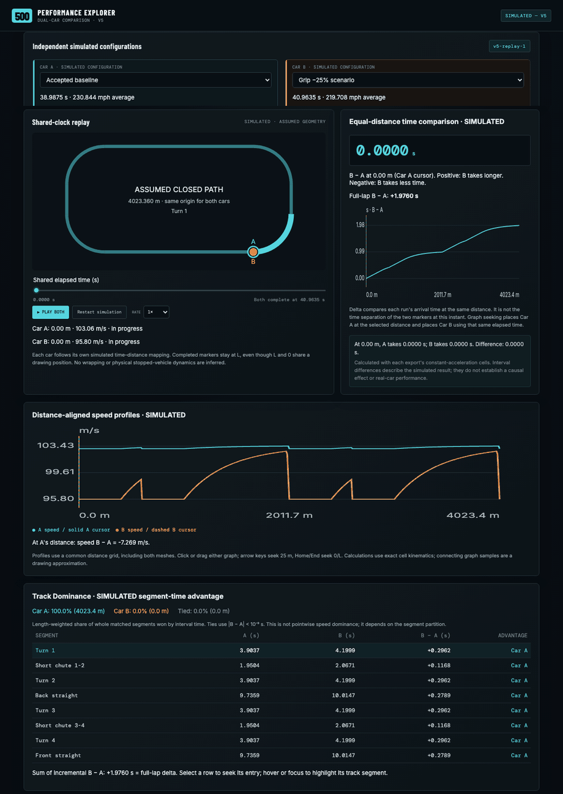
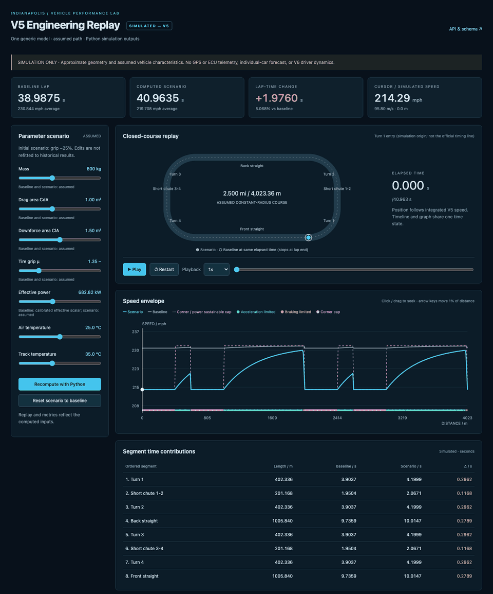
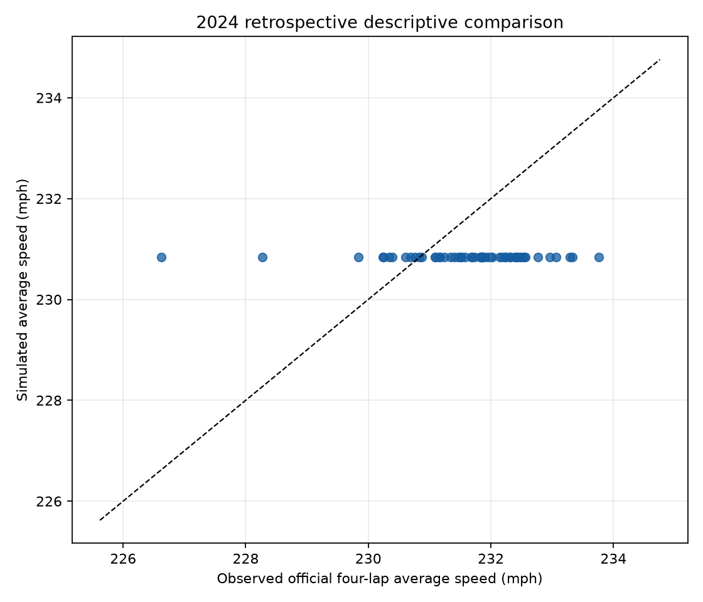
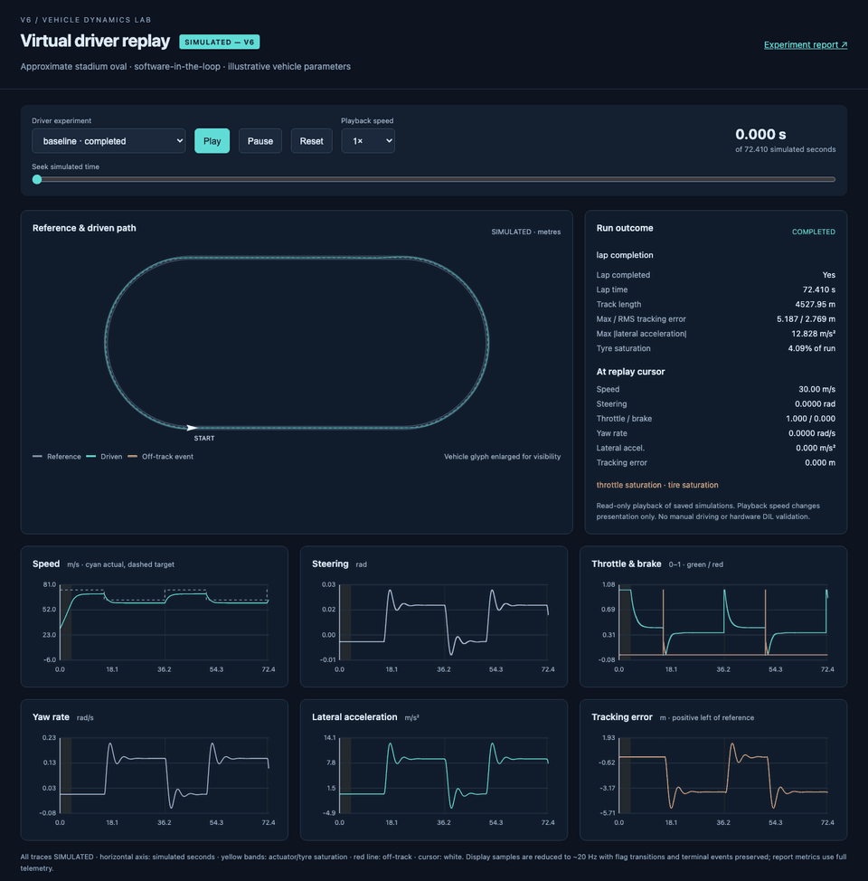
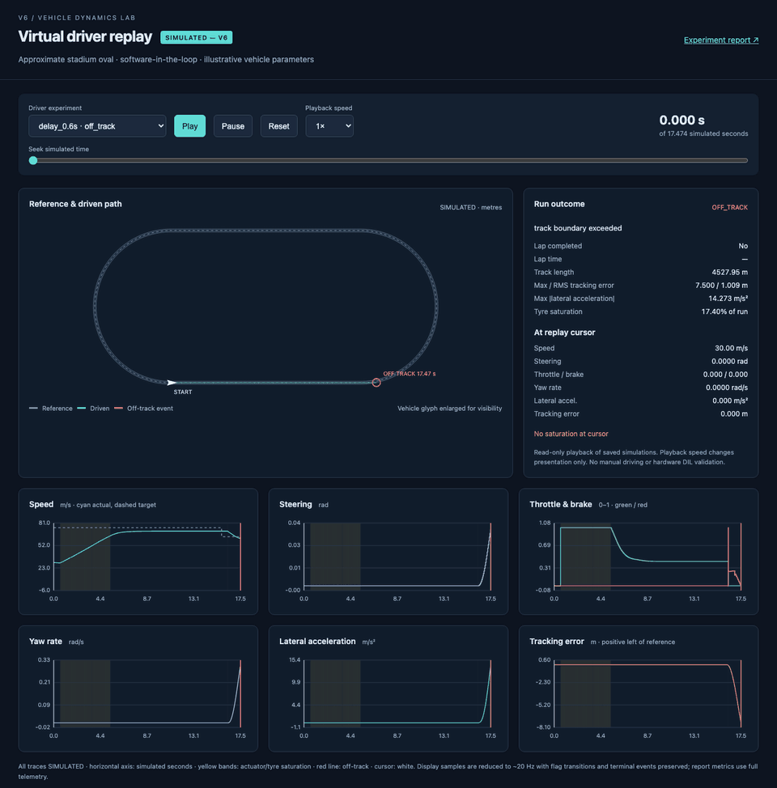
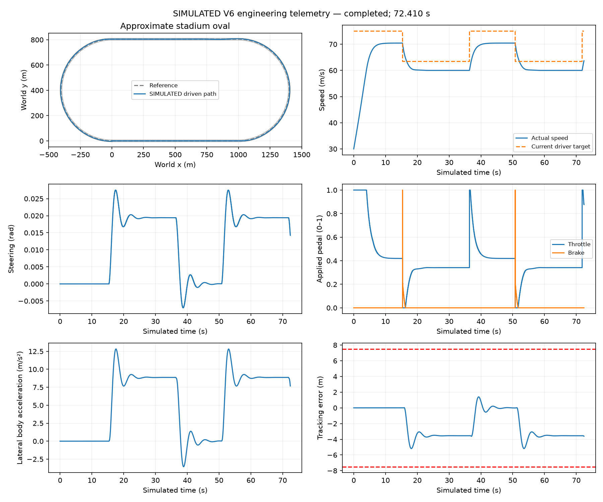
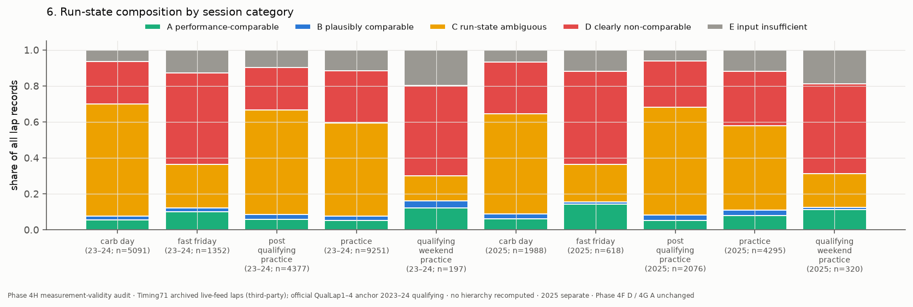
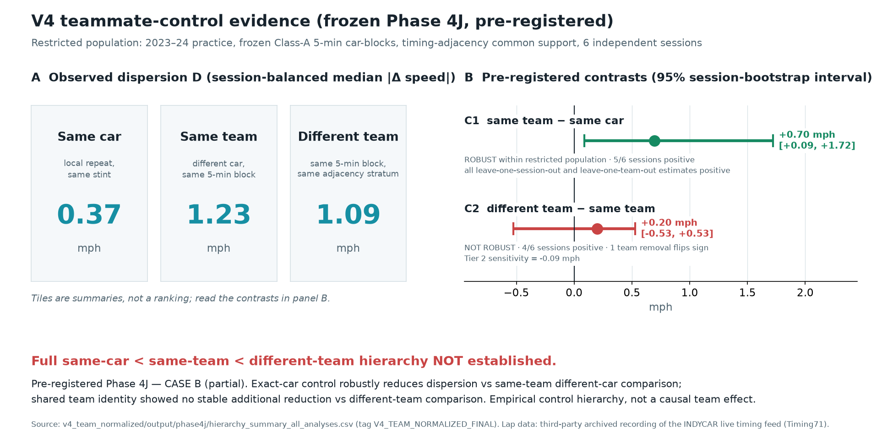

# Indy 500 — Point-in-Time Decision Support, Vehicle Simulation & Performance Explorer

A full-stack motorsport software and data engineering portfolio spanning **interactive dual-car telemetry & performance comparison (`Performance Explorer V1.1`)**, **quasi-steady closed-oval lap-time simulation (`V5`)**, **Software-in-the-Loop dynamic-bicycle vehicle dynamics & virtual-driver control (`V6`)**, **native C++17 temporal & physical computation (`C++17`)**, and **frozen point-in-time probabilistic decision support (`V2` / `V3` / `V4`)**.

**[V2](docs/final_v2_system_specification.md) | [V3](v3_point_in_time/README.md) | [V4](v4_team_normalized/README.md) | [V5](v5_lap_time_simulation/README.md) | [V6](v6_driver_in_loop/README.md) | [Performance Explorer](performance_explorer/README.md) | [C++17](cpp/README.md)**

**On this page:** [Module Guide](#architecture--module-overview) · [Performance Explorer V1.1](#performance-explorer-v11--unified-dual-car-comparison-ui) · [V5 Lap-Time Simulation](#v5--quasi-steady-lap-time-simulation--engineering-replay) · [V6 Vehicle Dynamics & Virtual Driver](#v6--vehicle-dynamics-rk4-integration--virtual-driver-sil) · [C++17 Native Engine](#c17--native-point-in-time--physical-computation-engine) · [V2 / V3 Decision Support](#v2--v3--point-in-time-probabilistic-decision-support) · [V4 Team-Normalized Study](#v4--team-normalized-evidence-extension) · [Complete Scientific Figure Atlas (36 Figures)](#scientific--application-figure-atlas-all-36-original-figures) · [Engineering Caveats & Verification](#engineering-caveats--reproducibility)

[](https://github.com/fengzhe-li/indy500-racing-point-in-time-decision-support/actions/workflows/ci.yml)
[](https://github.com/fengzhe-li/indy500-racing-point-in-time-decision-support/actions/workflows/explorer.yml)
[](https://github.com/fengzhe-li/indy500-racing-point-in-time-decision-support/actions/workflows/integrity.yml)

---

## Architecture & Module Overview

Every module in this repository enforces an explicit **evidence and provenance boundary** separating **historical observations (`OBSERVED`)**, **point-in-time or hypothetical statistical inference (`FINAL_V2` / `FINAL_V3_FROZEN` / `V4_TEAM_NORMALIZED_FINAL`)**, and **physics-based trajectory simulations (`SIMULATED — V5` / `SIMULATED — V6`)**.

| Module | Evidence Class | Core Engineering & Technical Scope | Stack & Verification | Primary Documentation |
|---|---|---|---|---|
| **[Performance Explorer V1.1](performance_explorer/README.md)** | `OBSERVED` + `SIMULATED (V5)` + `SIMULATED (V6)` | Unified React/TypeScript dual-car comparison interface supporting 196 official historical qualifying attempts, interactive V5 dual-car simulation overlays, and integrated V6 schema-2 dynamic telemetry replay | React 18 · TypeScript · Vite · Vitest · Python data audit & integrity checks | [Explorer README](performance_explorer/README.md) · [Data Contract](performance_explorer/docs/DATA_CONTRACT.md) · [Validation](performance_explorer/docs/VALIDATION.md) |
| **[V5 Lap-Time Simulation](v5_lap_time_simulation/README.md)** | `SIMULATED — V5` | Quasi-steady closed-loop spatial speed solver on an assumed `4023.360 m` (`2.5 mi`, `9.2°` banked) 8-segment oval, mesh convergence audit (`40 m` to `1.25 m`), sensitivity experiments, retrospective 2024 comparison, and FastAPI + React replay viewer | Python · NumPy · FastAPI · React/TypeScript (`v5-replay-1` schema) | [V5 README](v5_lap_time_simulation/README.md) · [Physics Model](v5_lap_time_simulation/docs/PHYSICS_MODEL.md) · [Engineering Results](v5_lap_time_simulation/docs/ENGINEERING_RESULTS.md) |
| **[V6 Vehicle Dynamics & Virtual Driver](v6_driver_in_loop/README.md)** | `SIMULATED — V6` | Audited planar dynamic-bicycle Software-in-the-Loop (SIL) simulator with classical RK4 integration, circular combined-slip tyre saturation, pure-pursuit + anti-windup PID virtual driver, `≤1 ns` boundary/finish bisection, 19-scenario robustness matrix (`14` completed / `5` off-track), and standalone Canvas telemetry viewer | Python 3.10+ stdlib · ES Modules / HTML5 Canvas · Node test runner (`44` Python + `9` JS tests) | [V6 README](v6_driver_in_loop/README.md) · [Vehicle Dynamics](v6_driver_in_loop/docs/VEHICLE_DYNAMICS.md) · [Controller Design](v6_driver_in_loop/docs/CONTROLLER_DESIGN.md) |
| **[C++17 Performance Engine](cpp/README.md)** | Additive Native Compute | Native C++17 implementation of ISO-8601 UTC parsing, fail-closed `known_at <= decision_time` leakage guards, observation lookback filtering, HRRR forecast-vintage selection, NOAA solar elevation, and `M2b`/Monte Carlo evaluation with transparent Python fallback | C++17 · CMake · GoogleTest (`16/16`) · `pybind11` parity suite (`12/12`) | [C++17 README](cpp/README.md) · [`pit_engine.hpp`](cpp/include/indy500/pit_engine.hpp) · [Parity Tests](v3_point_in_time/tests/test_cpp_engine_parity.py) |
| **[V2 / V3 Point-in-Time System](v3_point_in_time/README.md)** | `FINAL_V2` / `FINAL_V3_FROZEN` | Frozen physics-conditioned probabilistic response core (`41` same-car transitions, `39/41` section-linked, `15/30/60/90/120 min` horizons) wrapped in a fail-closed historical shadow replay engine, isolated Scenario Mode, read-only Docker containers, and 5-page React UI | Python · FastAPI · React/TypeScript · Docker (`read_only: true`, non-root) · `101/101` V3 tests | [V2 Specification](docs/final_v2_system_specification.md) · [V3 Application](v3_point_in_time/README.md) · [Extended Evidence](docs/PORTFOLIO_EVIDENCE.md) |
| **[V4 Team-Normalized Study](v4_team_normalized/README.md)** | `V4_TEAM_NORMALIZED_FINAL` | Frozen additive study normalizing `59` entrant labels to `21` canonical engineering teams (`2018–2025`), auditing practice run-state comparability (`8.1%` Class-A), and testing the `same car < same team < different team` dispersion hierarchy (`Phase 4J/4K/4L`) | Python · Pre-registered phases (`735`-file SHA-256 manifest, `17/17` Phase 4L checks) | [V4 README](v4_team_normalized/README.md) · [Scientific Synthesis](v4_team_normalized/output/phase4l/phase4l_final_scientific_synthesis.md) |

---

## Performance Explorer V1.1 — Unified Dual-Car Comparison UI

The **[Indy 500 Dual-Car Performance Explorer](performance_explorer/README.md)** provides a unified React/TypeScript engineering interface that brings together three distinct evidence domains—**Historical (`OBSERVED`)**, **V5 Quasi-Steady Simulation (`SIMULATED — V5`)**, and **V6 Vehicle-Dynamics Telemetry (`SIMULATED — V6`)**—without mixing incompatible track geometries or inventing unobserved telemetry.

### Mode 1 & Mode 2 Visual Evidence: V5 Dual-Car Replay vs. Integrated V6 Telemetry Replay



*Above — **`SIMULATED — V5` in Performance Explorer V1.1:** Synchronized dual-car playback comparing the published V5 baseline (`Car A`: `38.9875 s`, `230.844 mph`, $\mu = 1.80$) against the reduced-grip configuration (`Car B`: `40.9635 s`, `219.708 mph`, $\mu = 1.35$, `+1.9760 s` / `+5.068%`). Displays shared-clock position progression around the assumed `4023.36 m` 8-segment oval, distance-aligned speed envelopes, equal-distance arrival delta $\Delta t(s) = t_B(s) - t_A(s)$, segment-by-segment Track Dominance (`Car A: 100.0% / 4023.4 m`), and independent finish clamping (`Car A ✓` clamps at `38.9875 s` while `Car B` continues to completion at `40.9635 s`). [**Watch full-resolution MP4 (`explorer-dual-car.mp4`) →**](docs/media/explorer-dual-car.mp4) · [**Media provenance →**](docs/media/README.md)*


*Above — **`SIMULATED — V6` in Integrated Performance Explorer V1.1:** Authentic browser recording captured from `performance_explorer/frontend/` operating on the audited schema-2 V6 exports (`baseline.json` vs. `delay_0.6s.json`). Shows synchronized playback at `2×` and `10×` rates, pause/restart/seek controls, live vehicle poses on the `4527.95 m` analytical stadium oval, synchronized speed/steering/pedal/yaw/lateral-acceleration/tracking-error traces, and independent terminal-state handling: the `600 ms` steering-delay car clamps off-track at **`17.473821 s`** (`OFF_TRACK — track boundary exceeded`, `-7.500 m` error) while the baseline car completes the full lap in **`72.409997 s`** (`COMPLETED`). [**Watch full-resolution MP4 (`explorer-v6-integrated.mp4`) →**](docs/media/explorer-v6-integrated.mp4) · [**Explorer setup & data contracts →**](performance_explorer/README.md)*

### How the Three Explorer Modes Differ

| Explorer Mode | Provenance Label | Data Source & Sample Scope | Track Geometry | Playback Clock & Spatial Semantics | Supported Engineering Comparisons |
|---|---|---|---|---|---|
| **Historical Timing** | **`OBSERVED`** | `196` retained complete Day 1 four-lap qualifying attempts (`2020–2024`: `46 / 50 / 39 / 30 / 31` per year) audited from canonical timing records | Official `2.5 mi` (`4023.36 m`) IMS four-lap qualifying distance | **Discrete lap-boundary progression** (`Laps 1–4`). No GPS or continuous intra-lap trajectory exists in public timing records, so cars advance at verified lap boundaries without synthetic spline interpolation | Four-lap cumulative elapsed time, per-lap official durations/speeds, lap-by-lap delta, and matched section comparisons where official section schemas align |
| **V5 Quasi-Steady Lap Simulation** | **`SIMULATED — V5`** | Bundled `v5-baseline.json` & `v5-low-grip.json` exports (`v5-replay-1`), imported V5 JSON files, or live Python FastAPI recomputations (`POST /api/v5/simulate`) | Assumed **`4023.360 m`** closed 8-segment IMS oval (`4 × 402.336 m` turns at $R = 256.135\text{ m}$, $9.2^\circ$ banking) | **Continuous shared simulation clock** with distance-indexed interpolation (`≤10 m` spatial mesh) and independent finish clamping (`Car A` and `Car B` clamp at their own simulated lap times) | Speed overlay $v(s)$, equal-distance arrival delta $t_B(s) - t_A(s)$, 8-segment **Track Dominance**, and parameter sensitivity deltas (`mass`, $C_dA$, $C_lA$, $\mu$, power, $T_{\text{air}}$, $T_{\text{track}}$) |
| **V6 Vehicle Dynamics & Driver Replay** | **`SIMULATED — V6`** | Audited **schema-2 (`v6-replay-2`)** dynamic-bicycle RK4 exports (`baseline.json` and `delay_0.6s.json` bundled in V1.1) | Illustrative **`4527.951644 m`** closed flat stadium (`2 × 1000 m` straights + `2 × R=402.336 m` semicircles, `±7.5 m` boundary) | **Continuous shared time clock** ($\Delta t = 10\text{ ms}$ samples) interpolating continuous pose $(x, y, \psi)$ while zero-order holding actuator commands and status flags up to each car's exact terminal event (`COMPLETED` vs. `OFF_TRACK`) | Synchronized dual-car trajectory & heading overlay, time-aligned speed, steering $\delta$, throttle/brake pedals, yaw rate $r$, lateral acceleration $a_y$, signed tracking error $e_y$, and common-progress distance delta |

> **Strict Cross-Mode Isolation Caveat:** Because **V5 (`4023.360 m` banked 4-turn oval)** and **V6 (`4527.951644 m` flat 2-turn stadium)** use fundamentally different track geometries and physics formulations, the Explorer never computes cross-mode lap-time deltas or cross-mode Track Dominance between V5 and V6, nor does it overlay simulated trajectories onto observed historical attempts.

### Quick Start: Running Performance Explorer Locally

Bundled **Historical (`OBSERVED`)**, **V5 (`SIMULATED`)**, and **V6 (`SIMULATED`)** replays work immediately out of the box without running a backend server:

```bash
cd performance_explorer/frontend
npm ci
npm test        # Run frontend unit & contract tests
npm run build   # Production TypeScript + Vite build
npm run dev     # Launch local development server
```

To enable **live V5 two-car parameter recomputation** (`GET /api/v5/baseline` and `POST /api/v5/simulate`) inside the Explorer, start the V5 FastAPI solver service in a separate terminal from the repository root:

```bash
python3 -m pip install -r v5_lap_time_simulation/requirements.txt
python3 -m v5_lap_time_simulation.server
# Listens on http://127.0.0.1:8005 (the Explorer Vite proxy's default V5_API_TARGET)
```

Full setup instructions, audit ledgers, and verification scripts are documented in [`performance_explorer/README.md`](performance_explorer/README.md), [`performance_explorer/docs/DATA_CONTRACT.md`](performance_explorer/docs/DATA_CONTRACT.md), [`performance_explorer/docs/DATA_AUDIT.md`](performance_explorer/docs/DATA_AUDIT.md), and [`performance_explorer/docs/VALIDATION.md`](performance_explorer/docs/VALIDATION.md).

---

## V5 — Quasi-Steady Lap-Time Simulation & Engineering Replay

The **[`v5_lap_time_simulation/`](v5_lap_time_simulation/README.md)** module implements an isolated Python/NumPy quasi-steady spatial lap-time solver paired with a dedicated FastAPI service and React/TypeScript engineering replay viewer. It models aerodynamic drag, downforce, banked normal and lateral tyre-force limits, longitudinal friction-circle coupling, drivetrain power limits, and forward/backward integration passes around an explicitly assumed **`4023.360 m` (`2.5 mi`)** closed eight-segment oval.

### Standalone V5 Interactive Engineering Viewer



*Above — **`SIMULATED — V5` Standalone Engineering Viewer (`http://127.0.0.1:8005`):** Interactive replay generated from verified Python solver exports (`v5_lap_time_simulation/output/replay.json` vs. `replay_low_grip.json`). Compares the recalibrated baseline (**`38.987453 s`**, **`230.843500 mph`** average speed, effective power scalar **`682.824947 kW`**, $\mu = 1.80$) against a **`-25%` tire-grip perturbation** (**`40.963472 s`**, **`219.708 mph`**, $\mu = 1.35$, **`+1.976019 s` / `+5.068346%`** lap delta). Shows synchronized ghost-car progression, acceleration/braking regime shading, and 8-segment time contributions (`+0.296197 s` per turn, `+0.116753 s` per short chute, `+0.278862 s` per main straight). [**Watch full-resolution MP4 (`v5-physics-comparison.mp4`) →**](docs/media/v5-physics-comparison.mp4) · [**V5 module documentation →**](v5_lap_time_simulation/README.md)*

### V5 Spatial Speed Profile, Sensitivity Analysis & Retrospective 2024 Benchmark


*Above — **V5 Spatial Quasi-Steady Speed Profile (`v5_lap_time_simulation/output/speed_profile.png`):** Simulated speed (`230.548823–231.375288 mph`) versus track distance (`0.0–2.5 mi` / `4023.360 m`) for the baseline vehicle ($\mu = 1.80$, $9.2^\circ$ banking, corner radius $R = 256.135\text{ m}$). After auditing and correcting the legacy mixed flat/banked normal-load equations (increasing turn normal load from `16,682.434 N` to `21,553.986 N` and lowering lateral tire utilization at the legacy reference speed from `103.572%` to `75.899%` while reserving longitudinal tire capacity against aerodynamic drag), the baseline car remains **power-limited** below its sustainable cornering cap across all four turns, exhibiting small speed variations driven by bank-induced normal load and rolling resistance. When tire grip is reduced by `25%` ($\mu = 1.35$), the sustainable cornering cap drops below straightaway speed, activating explicit braking entry and acceleration exit zones.*

| Single-Factor Parameter Sensitivity (`sensitivity.png`) | Retrospective 2024 Descriptive Comparison (`historical_comparison.png`) |
|---|---|
|  |  |
| **Assumed-Model Perturbation Sensitivity:** Evaluates one-factor perturbations around the `38.987453 s` baseline while holding the calibrated `682.824947 kW` power scalar fixed. Available power `+10%` reduces lap time by **`-1.232977 s` (`-3.162%`)** and drag area $C_dA$ `+10%` adds **`+1.212310 s` (`+3.109%`)**. Air temperature `+10 °C` reduces lap time by **`-0.419448 s` (`-1.076%`)** through lower air density $\rho$ (holding engine power fixed). Mass `+10%` adds **`+0.036528 s`** and downforce area $C_lA$ `+10%` (with $C_dA$ held constant) adds **`+0.028116 s`** via higher induced normal load and rolling resistance in a power-limited regime. Tire grip `+5%` and track temperature `+10 °C` produce **`0.000000 s`** change because the baseline corners already have unused lateral tire margin. | **Retrospective 2024 Benchmark (`54` Complete Attempts):** The single effective power scalar (`682.825 kW`) is calibrated to match the pooled median official four-lap average speed of `206` complete `2020–2023` qualifying attempts (**`230.843500 mph`**). Because V5 uses one generic vehicle configuration with no car-, team-, setup-, driver-, or attempt-specific inputs, its retrospective 2024 prediction is a horizontal constant at **`230.843500 mph`**. Across `54` complete 2024 attempts, V5 achieves a speed MAE of **`1.142815 mph`** and RMSE of **`1.400540 mph`** (four-lap time MAE **`0.769258 s`**, RMSE **`0.944403 s`**)—**identically matching the training-median constant-speed predictor**. |

### V5 Quantitative Summary, Numerical Mesh Audit & Predictive Limitations

| Metric / Experiment | Verified V5 Output | Engineering Interpretation & Limitation |
|---|---|---|
| **Assumed Track Geometry** | `4023.360 m` (`2.500 mi`) closed oval | `2 × 1005.840 m` main straights, `2 × 201.168 m` short chutes, `4 × 402.336 m` turns ($R = 256.135\text{ m}$, $9.2^\circ$ banking); **distinct from V6's `4527.95 m` stadium** |
| **Baseline Calibration (`2020–2023`)** | `38.987453 s` (`230.843500 mph`) | Effective power scalar **`682.824947 kW`** fitted to the `206`-attempt `2020–2023` pooled median speed at `≤10 m` spatial step |
| **Grip `-25%` Scenario ($\mu = 1.35$)** | `40.963472 s` (`219.708 mph`) | **`+1.976019 s` (`+5.068346%`)** slower than baseline; corner-limited with braking and acceleration transitions |
| **Spatial Mesh Refinement (`≤10 m` vs. `1.25 m`)** | Baseline $\Delta t = 0.000670\text{ s}$ (`0.014219 m/s` RMSE); Grip `-25%` $\Delta t = 0.005681\text{ s}$ (`0.026001 m/s` RMSE) | Evaluated across `40, 20, 10, 5, 2.5, 1.25 m` grids without recalibrating; local profile maxima (`0.315–0.353 m/s`) occur in short transition cells |
| **2024 Retrospective Speed MAE / RMSE** | **`1.142815 mph` / `1.400540 mph`** (`n = 54`) | **Identical to the `230.843500 mph` training-median benchmark** (bias `-0.755722 mph`); outperforms training mean (`1.268939 / 1.513062 mph`) and fixed `230 mph` (`1.794148 / 1.986934 mph`) solely due to the median calibration target |

> **V5 Engineering Caveats:**
> 1. **No aggregate predictive gain over the training-median benchmark:** Fitting one global scalar to the `2020–2023` median speed reproduces the training median (`230.843500 mph`), so its 2024 error (`1.142815 mph` MAE) equals the constant training-median predictor up to floating-point precision.
> 2. **Retrospective descriptive scope & no spatial telemetry validation:** 2024 data was excluded from scalar fitting but inspected during development. Public INDYCAR timing reports provide 9-section (`2020–2023`) and 17-section (`2024`) summaries without continuous GPS/ECU speed traces or a verified distance crosswalk to V5's 8 analytical segments.
> 3. **Reproduce V5 locally:** Run `python3 -m v5_lap_time_simulation.cli --data-dir data/canonical/v1 --output-dir v5_lap_time_simulation/output` and `python3 -m unittest discover -s v5_lap_time_simulation/tests -p 'test_*.py' -v`. See [`v5_lap_time_simulation/docs/PHYSICS_MODEL.md`](v5_lap_time_simulation/docs/PHYSICS_MODEL.md), [`ENGINEERING_RESULTS.md`](v5_lap_time_simulation/docs/ENGINEERING_RESULTS.md), and [`VALIDATION_REPORT.md`](v5_lap_time_simulation/docs/VALIDATION_REPORT.md).

---

## V6 — Vehicle Dynamics, RK4 Integration & Virtual Driver (SIL)

The **[`v6_driver_in_loop/`](v6_driver_in_loop/README.md)** module is a self-contained **Software-in-the-Loop (SIL)** dynamic vehicle simulator and read-only telemetry replay system implemented in pure Python 3.10+ and zero-dependency ES Modules / HTML5 Canvas. Unlike V5's quasi-steady spatial boundary-value solver, V6 integrates time-domain equations of motion forward in time under closed-loop feedback from a configurable virtual driver.

### Standalone V6 Dynamics Replay & Side-by-Side Scenario Comparison


*Above — **`SIMULATED — V6` Standalone Telemetry Viewer (`v6_driver_in_loop/viewer/`):** Sequential capture of the standalone V6 dynamics viewer replaying the completed baseline run (**`72.409997 s`**, max tracking error **`5.18681 m`**) followed by the `600 ms` command-delay run (**`OFF_TRACK`** at **`17.473821 s`**, boundary violation at **`-7.50000 m`**). Displays the reference centerline, `±7.5 m` track boundaries, live vehicle pose and heading vector, playback controls (`1× / 2× / 4× / 8×`, seek slider), and six synchronized telemetry traces. This standalone Canvas viewer is separate from the two-car [Integrated Performance Explorer V1.1 V6 view](#performance-explorer-v11--unified-dual-car-comparison-ui). [**Watch full-resolution combined MP4 (`v6-vehicle-dynamics.mp4`) →**](docs/media/v6-vehicle-dynamics.mp4) · [**V6 module documentation →**](v6_driver_in_loop/README.md)*

| Completed Baseline Scenario (`v6-baseline-completed.gif`) | 600 ms Steering-Delay Off-Track Scenario (`v6-delay-off-track.gif`) |
|---|---|
|  |  |
| **`baseline.json` — `COMPLETED` (`72.409997 s` at $\Delta t = 10\text{ ms}$):** Undelayed pure-pursuit steering (`35 m` lookahead, gain `1.2`) and curvature-preview PID speed control complete the full **`4527.951644 m`** stadium lap. Speed ranges from **`30.000 m/s`** (initial) to **`70.441 m/s`** (straights) with a **`62.842 m/s`** time-weighted mean (`~60.0 m/s` steady cornering). Lateral tracking error peaks at **`5.18681 m`** (`2.76899 m` RMS), staying well inside the `±7.500 m` corridor with **`4.09%`** tire-saturation occupancy and **`12.8275 m/s²`** peak lateral acceleration. [**Watch `v6-baseline-completed.mp4` →**](docs/media/v6-baseline-completed.mp4) | **`delay_0.6s.json` — `OFF_TRACK` at `17.473821 s` (`17.474 s`):** Adding a **`600 ms` FIFO actuator delay queue** holds requested steering and braking commands in flight across `60` control steps ($\Delta t = 10\text{ ms}$). The car enters Turn 1 (`s ≈ 1000 m` at `t ≈ 15.6 s`) at straightaway speed (`70.44 m/s`) before delayed turn-in and braking arrive, driving lateral acceleration to **`14.2727 m/s²`**, tire saturation to **`17.40%`**, and signed tracking error to the **`-7.50000 m`** outer boundary at **`17.473821 s`** (`track boundary exceeded`, localized to `≤1 ns`). [**Watch `v6-delay-off-track.mp4` →**](docs/media/v6-delay-off-track.mp4) |

### V6 Engineering Telemetry Plots & Interactive Viewer Controls

| Six-Panel Baseline Engineering Telemetry (`engineering.png`) | Standalone Replay Control & Pose Panel (`replay_preview.png`) |
|---|---|
|  |  |
| **Audited Baseline Telemetry (`v6_driver_in_loop/reports/engineering.png`):** Generated directly by `python3 -m v6_driver_in_loop.cli --plot`. Shows (1) driven trajectory vs. reference stadium oval (`4527.95 m`), (2) actual speed $\operatorname{hypot}(u, v)$ vs. driver curvature-preview target (`75.0 m/s` straight / `63.430 m/s` curve target), (3) front steering angle $\delta$ (`rad`, peaking at `0.0275 rad` on turn entry with understeer steady state `0.0194 rad`), (4) applied throttle and brake pedals (`[0, 1]`, showing sharp turn-entry braking pulses and `0.34` corner-maintenance throttle), (5) net body lateral acceleration $a_{y,\text{body}} = \dot{v} + ur = F_{y,\text{body}}/m$ (`12.83 m/s²` turn-entry peak, `8.85 m/s²` steady cornering), and (6) signed lateral tracking error $e_y$ bounded within the `±7.5 m` dashed red limits. | **Read-Only Browser Replay Inspector (`v6_driver_in_loop/reports/replay_preview.png`):** Detail of the zero-dependency HTML5 Canvas viewer (`v6_driver_in_loop/viewer/`). Provides a selector across all **19 pre-computed scenario exports** (`14 completed`, `5 off_track`), play/pause/reset controls, playback speed multiplier (`0.5×` to `8×`), continuous simulated-time seek scrubber (`30.000 s` of `72.410 s` shown), and real-time rendering of the driven trajectory and vehicle heading marker on the stadium oval. The viewer strictly reads exported JSON telemetry and never executes or alters the physical solver in the browser. |

### How V6 Works: Bicycle Model, RK4 Integrator, Virtual Driver & Tracking Error

1. **Planar Dynamic Bicycle Model ([`vehicle.py`](v6_driver_in_loop/vehicle.py), [`docs/VEHICLE_DYNAMICS.md`](v6_driver_in_loop/docs/VEHICLE_DYNAMICS.md)):**
   - **State & parameters:** Integrates the 7-component state vector $\mathbf{x} = (x, y, \psi, u, v, r, s)$ in SI units (world East/North position $x, y$, heading $\psi$, body forward/lateral velocities $u, v$, yaw rate $r$, and integrated path distance $s$ with $\dot{s} = \operatorname{hypot}(u, v)$). Default illustrative parameters represent an open-wheel formula car: $m = 850\text{ kg}$, $I_z = 1200\text{ kg}\cdot\text{m}^2$, wheelbase $L = 3.0\text{ m}$ ($l_f = 1.35\text{ m}$, $l_r = 1.65\text{ m}$), cornering stiffnesses $C_f = 90\text{ kN/rad}$ and $C_r = 100\text{ kN/rad}$, friction coefficient $\mu = 1.5$, drag area $C_dA = 1.2\text{ m}^2$, downforce area $C_lA = 3.0\text{ m}^2$, air density $\rho = 1.225\text{ kg/m}^3$.
   - **Wheel-frame slip angles & circular combined-force tyre envelope:** Computes front wheel-frame velocity components $u_f = u\cos\delta + (v + l_f r)\sin\delta$ and $v_f = -u\sin\delta + (v + l_f r)\cos\delta$, regularizing the slip denominator with $u_\epsilon = 2.0\text{ m/s}$ so stationary steering never produces artificial lateral forces:
     $$\alpha_f = -\operatorname{atan2}\bigl(v_f,\, \max(|u_f|, u_\epsilon)\bigr), \qquad \alpha_r = -\operatorname{atan2}\bigl(v - l_r r,\, \max(u, u_\epsilon)\bigr)$$
     Requested linear lateral forces ($F_{y,i}^{\text{req}} = C_i \alpha_i$) and longitudinal axle forces (rear-wheel drive $F_{\text{drive}} = 9000\text{ N} \times \text{throttle}$; smoothed brake demand $18000\text{ N} \times \text{brake} \times \tanh(u/0.2)$ split `55%` front / `45%` rear) are jointly scaled on each axle by $\min\bigl(1,\, \mu F_{z,i} / \operatorname{hypot}(F_{x,i}^{\text{req}}, F_{y,i}^{\text{req}})\bigr)$ where $F_{z,i}$ includes speed-squared aerodynamic downforce $q C_lA$ ($q = \frac{1}{2}\rho(u^2 + v^2)$).
   - **Front-force rotation & body accelerations:** Front axle forces are rotated by steering angle $\delta$ into the vehicle body frame ($F_{xf,\text{body}} = F_{xf}\cos\delta - F_{yf}\sin\delta$, $F_{yf,\text{body}} = F_{xf}\sin\delta + F_{yf}\cos\delta$) before subtracting vector aerodynamic drag and rolling resistance, yielding exact rigid-body equations $\dot{u} = F_{x,\text{body}}/m + vr$, $\dot{v} = F_{y,\text{body}}/m - ur$, $\dot{r} = (l_f F_{yf,\text{body}} - l_r F_{yr})/I_z$, and true net body accelerations $a_{x,\text{body}} = F_{x,\text{body}}/m$ and $a_{y,\text{body}} = F_{y,\text{body}}/m$.

2. **Classical RK4 Integration & Nanosecond Event Bisection ([`simulation.py`](v6_driver_in_loop/simulation.py), [`reports/CONVERGENCE_RESULTS.md`](v6_driver_in_loop/reports/CONVERGENCE_RESULTS.md)):**
   - Actuator commands are held constant over each external control step $\Delta t \in (0, 0.05]\text{ s}$ (default `10 ms`). Within each step, the solver advances via deterministic 4th-order Runge-Kutta (RK4) substeps $h \le \min(0.02\text{ s}, 0.25\tau)$, where $\tau = \min\bigl(mU/(C_f+C_r),\, I_z U/(C_f l_f^2 + C_r l_r^2)\bigr)$ and $U = \max(u, 2\text{ m/s})$, preventing explicit low-speed tire-damping instability.
   - When a step crosses the `±7.5 m` track boundary or completes the `4527.951644 m` net signed lap progress, the engine re-integrates the held command and **bisects event time to `≤1 ns`**.
   - **Timestep convergence audit:** Across $\Delta t \in \{20,\, 10,\, 5,\, 2.5\}\text{ ms}$, baseline lap times converge smoothly (**`72.4132 s` → `72.4100 s` → `72.4077 s` → `72.4068 s`**), with maximum same-time world position differences relative to `2.5 ms` of **`0.4063 m` (`20 ms`)**, **`0.2019 m` (`10 ms`)**, and **`0.0573 m` (`5 ms`)**.

3. **Virtual Driver Architecture ([`controller.py`](v6_driver_in_loop/controller.py), [`docs/CONTROLLER_DESIGN.md`](v6_driver_in_loop/docs/CONTROLLER_DESIGN.md)):**
   - **Lateral pure-pursuit steering:** Projects vehicle position onto the known reference centerline, advances by lookahead distance `preview_m = 35.0 m`, transforms the target into body coordinates $(dx, dy = y_t)$, and requests $\delta_{\text{req}} = k_{\text{steer}} \operatorname{atan2}(2 L y_t,\, dx^2 + dy^2)$ (default $k_{\text{steer}} = 1.2$), passed through a sampled first-order steering lag $1 - \exp(-\Delta t / \tau_{\text{steer}})$ and clamped to physical steering limits (`±0.45 rad`).
   - **Longitudinal curvature-preview PID & FIFO reaction delay:** Sets desired speed $v_{\text{target}} = \text{aggression} \cdot \min\bigl(v_{\max},\, \sqrt{a_{y,\lim} / |\kappa_{\text{preview}}|}\bigr)$ (`75.0 m/s` on straights; $\sqrt{10 \times 402.336} = 63.430\text{ m/s}$ in curves before aggression). A conditional anti-windup PID controller on body speed $u$ outputs signed pedal demand (scaled by `/5` for throttle or `/8` for brake, clipped to `[0, 1]`, with brake overriding throttle). When `reaction_delay_s > 0`, commands enter a deterministic FIFO queue and release on the first control tick at or after `t + reaction_delay_s`.

4. **Track Geometry, Tracking Error & 19-Scenario Robustness Matrix ([`track.py`](v6_driver_in_loop/track.py), [`reports/ROBUSTNESS_RESULTS.md`](v6_driver_in_loop/reports/ROBUSTNESS_RESULTS.md)):**
   - The analytical stadium oval consists of two `1000.0 m` straights and two semicircular turns of radius $R = 402.336\text{ m}$, giving a total centerline circumference of **`4527.951644 m`** and a `15.0 m` corridor (`±7.500 m` maximum permitted CG lateral tracking error $|e_y|$).
   - Across the **19 deterministic one-factor robustness scenarios**, **14 runs complete** the lap and **5 runs terminate `off_track`** without relaxing any boundary or stability threshold:

| Scenario (`v6_driver_in_loop/reports/robustness.csv`) | Terminal Status | Simulated Lap Time (`s`) | Max Tracking Error (`m`) | RMS Tracking Error (`m`) | Peak Lateral Accel (`m/s²`) | Tire Saturation Occupancy | Key Physical & Control Mechanism |
|---|---|---:|---:|---:|---:|---:|---|
| **`baseline`** ($\Delta t = 10\text{ ms}$, delay `0 s`, $\mu = 1.5$) | **`completed`** | **`72.409997`** | `5.18681` | `2.76899` | `12.8275` | `4.09%` | Reference SIL run; steady cornering understeer drift stays `2.31 m` inside the `7.50 m` limit |
| **`conservative`** (`aggression = 0.80`, `preview = 40 m`) | **`completed`** | **`90.373859`** | `3.12874` | `1.82252` | `7.9256` | `1.68%` | Lower corner entry and apex speed cuts peak lateral error by `39.7%` and tire saturation by `58.9%` |
| **`aggressive`** (`aggression = 1.12`, `preview = 28 m`) | **`completed`** | **`63.221075`** | `7.48895` | `3.69339` | `18.0807` | `4.68%` | Completes with only **`~11.05 mm` (`0.01105 m`)** margin to the `7.500 m` off-track wall |
| **`delay_0.1s`** (`100 ms` command delay) | **`completed`** | **`72.481166`** | `5.48751` | `2.78597` | `13.5846` | `4.11%` | Mild turn-entry overshoot (`+0.301 m` max error vs. baseline) remains damped |
| **`delay_0.3s`** (`300 ms` command delay) | **`completed`** | **`72.651203`** | `6.75530` | `2.89416` | `16.7285` | `4.13%` | Larger entry overshoot (`6.755 m` error, `0.745 m` margin) still recovers in Turn 1 |
| **`delay_0.6s`** (`600 ms` command delay) | **`off_track`** (`17.474 s`) | — | **`7.50000`** | `1.00918` | `14.2727` | `17.40%` | Delayed steering & braking enter Turn 1 at `70.44 m/s`; crosses `-7.500 m` boundary at `17.473821 s` |
| **`grip_0.8`** ($\mu = 0.80$) & **`grip_1`** ($\mu = 1.00$) | **`off_track`** | — | **`7.50000`** | `2.668 / 2.695` | `14.78 / 18.24` | `33.51% / 23.58%` | Insufficient lateral friction circle capacity ($\mu F_z$) to sustain Turn 1 curvature at target speed |
| **`steering_gain_0.6`** ($k_{\text{steer}} = 0.6$) | **`off_track`** | — | **`7.50000`** | `1.26786` | `12.4800` | `16.76%` | Under-responsive lateral loop fails to generate sufficient front slip angle before boundary |
| **`steering_gain_1.6`** ($k_{\text{steer}} = 1.6$) | **`completed`** | **`72.246148`** | `2.86633` | `1.56980` | `12.3343` | `4.10%` | Stronger lateral proportional authority halves steady-state cornering path error |
| **`offset_±2m` / `heading_±3deg` / `start_0mps` / `start_70mps` / `speed_gain_0.175 & 0.7`** | **`completed`** (`6` runs) | `70.724–75.974` | `5.031–5.190` | `2.556–2.899` | `12.47–12.83` | `0.00%–9.85%` | Initial perturbation transients decay before Turn 1 entry; `offset_+8m` immediately terminates `off_track` at `t = 0 s` as a boundary-guard sanity test |

> **V6 Engineering Caveats:** Every V6 output is **`SIMULATED — V6`** using an illustrative planar dynamic-bicycle model without track banking, suspension kinematics, transient vertical load transfer, tyre relaxation length, thermal degradation, or engine/gearbox maps. Its `4527.951644 m` stadium path is not surveyed IMS geometry and is never compared against V5 (`4023.360 m`) lap times. See [`v6_driver_in_loop/docs/PHYSICS_AUDIT.md`](v6_driver_in_loop/docs/PHYSICS_AUDIT.md) and [`SIMULATION_VALIDATION.md`](v6_driver_in_loop/docs/SIMULATION_VALIDATION.md).

---

## C++17 — Native Point-in-Time & Physical Computation Engine

While the Python stack (`pipeline/`, `weather/`, `v3_point_in_time/`) is the authoritative reference implementation for historical ingestion, replay orchestration, and FastAPI request serving, **[`cpp/`](cpp/README.md)** provides an additive **C++17 computational library (`indy500_pit_engine`)** with GoogleTest verification and optional `pybind11` bindings (`_indy500_pit_cpp`).

1. **Implemented Native Capabilities ([`cpp/include/indy500/pit_engine.hpp`](cpp/include/indy500/pit_engine.hpp), [`cpp/src/pit_engine.cpp`](cpp/src/pit_engine.cpp)):**
   - **ISO-8601 UTC parsing & fail-closed leakage guard** (`parse_iso8601_utc`, `check_point_in_time`, `enforce_point_in_time`): Proleptic Gregorian conversion enforcing `known_at <= decision_time` and `forecast.issue_time <= decision_time` (rejecting any record even `1 s` after `decision_time` with identical reason codes to Python).
   - **Timestamp-aware observation filtering & thermal rate lookback** (`filter_observations_at_cutoff`, `compute_point_in_time_thermal_rate`): Deterministic sorting by `(observed_at, known_at, id)`, strict `NaN`/`Inf`/duplicate validation, and 10–20 minute track heating/cooling rate calculation (`°C/min`).
   - **Vintage-aware HRRR forecast selection** (`ForecastVintageStore`): Pre-parses nominal cycle and valid timestamps into integer epochs on insertion, strictly excludes post-cutoff model runs, and breaks ties deterministically.
   - **Domain physics & Monte Carlo summarization** (`solar_elevation_deg`, `evaluate_applicability`, `evaluate_physical_response`, `summarize_draws`, `run_monte_carlo_inference`): Exact `1e-12` parity with the frozen `FINAL_V2` `M2b_mean_solar` and zero-intercept speed-response equations across all **656** frozen rows in `future_track_samples_with_solar_v1.csv`.

2. **Verification & Component Microbenchmarks ([`cpp/README.md`](cpp/README.md)):**
   - **16/16 C++ GoogleTest tests PASS** (`ctest --test-dir cpp/build --output-on-failure -V`) and **12/12 Python↔C++ parity & fallback tests PASS** (`python3 -m unittest discover -s v3_point_in_time/tests -p 'test_cpp_*.py' -v`).
   - Measured component microbenchmarks (macOS arm64, Apple clang `-O3`, median of 9 warm runs): `solar_elevation_deg` (`6,560` calls) runs in **`0.87 ms` direct / `5.04 ms` via bridge** vs. `10.49 ms` in Python (**`12.1×` / `2.1×`**); `ForecastVintageStore` (`259`-row init + `100` point-in-time queries) runs in **`0.224 ms`** vs. `6.68 ms` unmodified Python / `0.88 ms` pre-parsed Python (**`29.8×` / `3.9×`**); `check_point_in_time` (`10,000` evaluations) runs in **`2.45 ms`** vs. `12.01 ms` (**`4.9×`**).
   - **Production execution caveat:** These are component-level microbenchmarks, not end-to-end FastAPI speedups. Python remains the authoritative application implementation, and the production V3 FastAPI historical replay and scenario endpoints do **not** execute the C++ engine in their normal request paths.

---

## V2 / V3 — Point-in-Time Probabilistic Decision Support

**`FINAL_V2`** freezes a physics-conditioned probabilistic performance-response core (`p(Δv | H = h)`) over **41 same-car qualifying transitions** (`2020–2024`), with section-level mechanism linkage for **39/41 transitions** (`351` dependent within-transition section comparisons) and **656 current–future track-temperature sample pairs** across five independently calibrated horizons (**`15 / 30 / 60 / 90 / 120 minutes`**). **`FINAL_V3_FROZEN`** wraps that unchanged scientific core in an auditable point-in-time software architecture: vintage-tracked HRRR weather provenance, a fail-closed information-cutoff guard (`issue_time <= decision_time`), read-only historical shadow replay, an AST-isolated Hypothetical Scenario Mode (`HYPOTHETICAL_SCENARIO` / `NOT_HISTORICAL_EVIDENCE`), first-class machine-readable abstention reason codes, and a FastAPI + React/TypeScript + read-only Docker deployment (`101/101` V3 tests passing; `32/32` frozen V2 dependencies SHA-256 verified).

- **Frozen Zero-Intercept Physical Response (`r5_2/manual/probabilistic_physics_core_v1.json`):**
  $$\Delta v_{\text{physical}} = \beta_{\text{track}}\,\Delta T_{\text{track}} + \beta_{\text{ambient}}\,\Delta T_{\text{ambient}}, \qquad \beta_{\text{track}} = -0.034825\text{ mph/}^\circ\text{C},\quad \beta_{\text{ambient}} = +0.182393\text{ mph/}^\circ\text{C}$$
- **Three-Source Uncertainty & 135-Scenario Stress Test:** Combines paired bootstrap coefficient uncertainty, horizon-specific conformal future track-state (`M2b_mean_solar`) uncertainty, and centered leave-one-year-out empirical attempt residuals (removing empirical performance residuals shrinks mean 80% interval width by **`90.4%` at 15 min** and **`72.8%` at 120 min**). Across **135 stress-test scenarios** (`3 thermal gaps × 3 ambient paths × 3 solar states × 5 horizons`), 120-minute $P(\Delta v > 0)$ spans **`0.20552` to `0.6704`** (`[0.20552, 0.6704]`) and expected $\Delta v$ spans **`−0.4630` to `+0.2248 mph`**.
- **2025 External Hybrid-Era Evaluation (`15` cases) & Point-in-Time Replay Boundary:** Across **15** eligible 2025 same-car repeat cases (retrospective realized-weather physical evaluation), overall MAE is **`0.492 mph`** (`0.491600 mph`), RMSE is **`0.610 mph`**, 80% / 90% prediction-interval coverage is **`80%` / `100%`**, and directional accuracy is **`46.7%`** (`0.466667`). Only **4** cases fall inside the `≤120 min` production horizon boundary (MAE `0.221 mph`, RMSE `0.269 mph`, directional accuracy `50.0%`). In `FINAL_V3` historical shadow replay, of `41` transitions, `31` pre-candidates are excluded/abstained for timestamp ambiguity, leaving **10 genuine point-in-time candidates** (`9` with 5-horizon inference support but abstained from scoring because realized horizon `> 120 min`, plus `1` illustrative near-anchor case, 2021 Car 60, where forecast `+0.0236 mph` and realized `+0.0451 mph` expectations both differed from the `+4.695 mph` observed jump) and **0 cases** contributing to formal aggregate historical-scoring validation.
- **Human-in-the-Loop Decision Boundary:** Public records do not consistently expose queue entry, Lane 1/Lane 2 priority, withdrawals, or team intent. The system estimates conditional physical performance $p(\Delta v \mid H = h)$ for a supplied horizon $h$; it never estimates opportunity probability $P(H = h)$ or recommends whether to retain or withdraw a qualifying time. Details: [V2 specification](docs/final_v2_system_specification.md) · [V3 README](v3_point_in_time/README.md) · [Extended Evidence Reference](docs/PORTFOLIO_EVIDENCE.md).

---

## V4 — Team-Normalized Evidence Extension

**`V4_TEAM_NORMALIZED_FINAL`** is a separately frozen, additive methodological study (`735`-file SHA-256 manifest, `17/17` Phase 4L checks passing) that preserves all `FINAL_V2` and `FINAL_V3_FROZEN` assets unchanged. It tests whether same-team, different-car observations can serve as an intermediate control layer between exact-car repeats and unrelated cars:

- **Canonical Team Entity Resolution (`2018–2025`):** Rule-based normalization (`51` explicit rules, zero fuzzy matching) maps `59` raw official entrant labels to **21 canonical engineering teams**, recovering `85` of `313` true teammate pairs (`27%`) missed by raw entrant strings without introducing false pairings.
- **Practice Measurement Validity (`Phase 4H`):** Only **8.1%** of at-speed 2023–2024 practice laps met the frozen, qualifying-calibrated Class-A performance-comparability rule; raw practice laps cannot be pooled as homogeneous performance attempts.
- **Pre-Registered Dispersion Hierarchy Test (`Phase 4J`, Primary Tier-1 2023–2024 across 6 independent sessions):** Observed performance dispersion is **0.37 mph** for the same car, **1.23 mph** for the same team, and **1.09 mph** for different teams:
  - **C1 = same team − same car = +0.70 mph** [+0.09, +1.72]. **Robust** exact-car control benefit (positive in `5/6` sessions and every leave-one-session-out / leave-one-team-out check).
  - **C2 = different team − same team = +0.20 mph** [−0.53, +0.53]. **Not robust:** the full three-level hierarchy (*same car < same team < different team*) was **not established** (`PRIMARY_CASE = B`).
- **Prospective Teammate-Prediction Attrition (`Phase 4K`):** Of **113** teammate-assisted target events (`F0`), only **8** strict leakage-free cases (`F5`) survived point-in-time and comparability filters. Teammate predictive value remains prospectively unidentifiable from the current record; this is **not** evidence that teammate predictive value is zero.
- **Documentation:** [V4 README](v4_team_normalized/README.md) · [Phase 4L Final Scientific Synthesis](v4_team_normalized/output/phase4l/phase4l_final_scientific_synthesis.md) · [Claims Matrix](v4_team_normalized/output/phase4l/phase4l_claims_matrix.csv) · [Evidence Chain](v4_team_normalized/output/phase4l/phase4l_evidence_chain.md).

---

## Scientific & Application Figure Atlas (All 36 Original Figures)

All **36 original research and application figures** are preserved directly below on the repository homepage, organized by subsystem with side-by-side comparison tables for paired diagrams/screens and full-width layouts for detailed multi-panel diagnostic charts. Complete numerical tables and derivations are also cross-referenced in [`docs/PORTFOLIO_EVIDENCE.md`](docs/PORTFOLIO_EVIDENCE.md) and [`figures/GALLERY.md`](figures/GALLERY.md).

### 1. Point-in-Time System Boundary, V3 Architecture & Application Screens (Figures 1–6)

| Figure 1 — Identifiability-Driven System Boundary | Figure 2 — `FINAL_V3` Point-in-Time Application Architecture |
|---|---|
|  |  |
| Separates the identifiable conditional physical response $p(\Delta v \mid H = h)$ from unobservable queue mechanics $P(H = h)$ and human pit-wall utility decisions. | Strict separation between the read-only point-in-time historical replay pipeline and the ephemeral hypothetical Scenario Mode sharing the frozen `FINAL_V2` adapter. |

| Figure 3 — Pit-Wall Outlook UI (`01_pit_wall_outlook.png`) | Figure 4 — Hypothetical Scenario Mode UI (`02_scenario_mode.png`) |
|---|---|
|  |  |
| Conditional physical outlook across all five calibrated horizons (`15 / 30 / 60 / 90 / 120 min`) for the deterministically selected non-illustrative default case. | Isolated hypothetical scenario inference explicitly badged `HYPOTHETICAL SCENARIO — NOT HISTORICAL EVIDENCE` and blocked from writing to historical stores. |

| Figure 5 — Historical Shadow Replay UI (`03_historical_replay.png`) | Figure 6 — Validation & Abstention Accounting UI (`05_validation_abstention.png`) |
|---|---|
|  |  |
| Time-ordered replay events enforcing the `known_at <= decision_time` and `forecast.issue_time <= decision_time` cutoff boundary. | Authoritative evidence attrition (`41` transitions → `10` point-in-time candidates → `0` formal aggregate scoring cases) and structured abstention reason breakdown. |

### 2. Evidence Engineering, Data Provenance & Frozen Physical Response (Figures 7–13)

| Figure 7 — Evidence Engineering Pipeline | Figure 8 — Multi-Layer Evidence Hierarchy |
|---|---|
|  |  |
| Source-registry ingestion, canonical reconciliation across `329` attempts / `1,174` laps / `9,898` section rows, and field-level provenance (`133,138` links). | Observational units across the `41` same-car transitions, `39` section-linked transitions (`351` within-transition pairs), and `656` future track-state pairs. |


*Above — **Figure 9 (`evidence-products-and-attrition.svg`):** Canonical data products, eligibility filtering across `12,998` evaluations, and explicit quarantine of unresolved chronology or weather joins.*

| Figure 10 — Same-Car Transition Design | Figure 11 — Frozen Zero-Intercept Physical Response |
|---|---|
|  |  |
| Exact-car within-day repeat qualifying design controlling for chassis, engine, aero baseline, and driver identity across `41` transitions (`2020–2024`). | Huber-robust zero-intercept thermal response: $\beta_{\text{track}} = -0.034825\text{ mph/}^\circ\text{C}$ and $\beta_{\text{ambient}} = +0.182393\text{ mph/}^\circ\text{C}$. |


*Above — **Figure 12 (`physical-state-transition-examples.png`):** Concrete same-car transition examples illustrating measured $\Delta T_{\text{track}}$ and $\Delta T_{\text{ambient}}$ alongside the gap between modelled physical contribution and total realized speed change.*


*Above — **Figure 13 (`observed-vs-frozen-physical-prediction.png`):** Observed four-lap qualifying speed change versus frozen deterministic physical prediction across the `41`-transition reference core, highlighting why attempt-level residual uncertainty must be propagated.*

### 3. Future Track-State Model, Three-Source Uncertainty & LOYO Stability (Figures 14–20)

| Figure 14 — Future Track-State Pathway (`M2b_mean_solar`) | Figure 15 — Three-Source Probabilistic Uncertainty Architecture |
|---|---|
|  |  |
| Horizon-specific track-temperature model conditioning on future ambient change, current track–ambient thermal gap, and mean solar elevation (`656` pairs). | Monte Carlo combination of paired-bootstrap coefficient draws, conformal future track-temperature intervals, and centered LOYO attempt residuals. |


*Above — **Figure 16 (`future-track-model-selection.png`):** Leave-one-year-out candidate model selection across horizons (`15 / 30 / 60 / 90 / 120 min`), motivating retention of `M2b_mean_solar` and rejection of extra rate/delta-solar complexity.*


*Above — **Figure 17 (`future-track-conformal-calibration.png`):** Horizon-specific future track-temperature conformal calibration diagnostics and empirical coverage across leave-one-year-out folds.*


*Above — **Figure 18 (`uncertainty-source-ablation.png`):** Uncertainty-source ablation demonstrating that removing empirical attempt-level performance residuals reduces 80% interval width by `90.4%` at `15 min` and `72.8%` at `120 min`.*

| Figure 19 — LOYO Track Coefficient Stability | Figure 20 — LOYO Ambient Coefficient Stability |
|---|---|
|  |  |
| Leave-one-year-out stability of $\beta_{\text{track}}$ across `2020–2024` reference folds. | Leave-one-year-out stability of $\beta_{\text{ambient}}$ across `2020–2024` reference folds. |

### 4. Horizon Calibration, Section Mechanism, Wind Diagnostics & Scenario Stress Tests (Figures 21–26)


*Above — **Figure 21 (`calibrated-horizon-boundary.svg`):** Scientific support exists at exact calibrated anchors (`15, 30, 60, 90, 120 min`); `OPERATIONAL_CURVE_V2` labels intermediate 1-minute points as `INTERPOLATED_OPERATIONAL` presentation summaries and forbids extrapolation above `120 min`.*

| Figure 22 — Section-Level Mechanism Coherence (`39/41`) | Figure 23 — Wind Residual Diagnostic |
|---|---|
|  |  |
| Mean directional coherence across 9 common track sections is `0.724` overall and `0.935` for the `12` transitions with $|\Delta v| \ge 0.50\text{ mph}$. | Fixed-point and gridded wind proxies exhibited weak/unstable out-of-year residual relationships and were not forced into `FINAL_V2`. |


*Above — **Figure 24 (`scenario-stress-test-120min.png`):** 120-minute slice of the `135`-scenario physical stress test (`3 thermal gaps × 3 ambient trajectories × 3 solar states × 5 horizons`), where $P(\Delta v > 0)$ spans `0.20552` to `0.6704`.*

| Figure 25 — Scenario Probability Range by Horizon | Figure 26 — Scenario Performance Envelope by Horizon |
|---|---|
|  |  |
| Evolution of $P(\Delta v > 0)$ across `15–120 min` horizons under cooling, flat, and warming ambient trajectories. | Evolution of expected $\Delta v$ (`−0.4630` to `+0.2248 mph` at `120 min`) and predictive interval envelopes across horizons. |

### 5. 2025 External Validation, Technical-Regime Transfer & V4 Team-Normalized Study (Figures 27–31)


*Above — **Figure 27 (`external-validation-2025.png`):** Retrospective physical evaluation of the frozen `2020–2024` core on `15` eligible `2025` hybrid-era same-car repeats (`MAE = 0.492 mph`, `RMSE = 0.610 mph`, `80% PI = 80%`, `90% PI = 100%`, `directional accuracy = 46.7%`; `4` cases inside the `≤120 min` production horizon with `MAE = 0.221 mph`).*

| Figure 28 — Technical-Regime Timeline (`2019–2026`) | Figure 29 — Cross-Regime Coefficient Comparison |
|---|---|
|  |  |
| Evolution from `2019` pre-Aeroscreen to `2020–2024` reference Aeroscreen era, `2025` hybrid era, and `2026` qualifying-format boundary. | Directional compatibility of thermal coefficients across `2019`, `2020–2024`, and `2025` (all 90% bootstrap difference intervals include zero). |

| Figure 30 — V4 Practice Run-State Composition (`Phase 4H`) | Figure 31 — V4 Control-Evidence Dispersion Summary (`Phase 4J`) |
|---|---|
|  |  |
| Breakdown of timed practice laps into Classes `A–E`: only **`8.1%`** of 2023–2024 at-speed practice laps meet the qualifying-calibrated Class-A comparability standard. | Same-car (`0.37 mph`), same-team (`1.23 mph`), and different-team (`1.09 mph`) dispersion across 6 sessions: `C1 = +0.70 mph [+0.09, +1.72]` (robust) vs. `C2 = +0.20 mph [−0.53, +0.53]` (not robust). |

### 6. Operational Outlook Overlays & Freeze Discipline (Figures 32–36)

| Figure 32 — Operational Performance Outlook Curve | Figure 33 — Operational Probability Outlook Curve |
|---|---|
|  |  |
| Calibrated anchor predictions (`15, 30, 60, 90, 120 min`) connected by explicitly labelled `INTERPOLATED_OPERATIONAL` 1-minute curves for expected/median $\Delta v$ and 80%/90% intervals. | Operational $P(\Delta v > 0)$ curve across `0–120 min` distinguishing calibrated scientific anchors from intermediate display interpolation. |

| Figure 34 — External Opportunity-Window Performance Overlay | Figure 35 — External Opportunity-Window Probability Overlay |
|---|---|
|  |  |
| Externally supplied pit-wall opportunity window overlaid onto the physical performance curve without predicting queue wait times. | Externally supplied opportunity window overlaid onto the improvement-probability trajectory to support human pit-wall judgement. |


*Above — **Figure 36 (`freeze-and-reproducibility.svg`):** SHA-256 manifest verification, artifact freeze boundaries (`FINAL_V2`, `R6_REGULATION_AWARE_EXTENSION_V1_FROZEN`, `FINAL_V3_FROZEN`, `V4_TEAM_NORMALIZED_FINAL`), and isolation from additive simulation modules (`V5`, `V6`, `Performance Explorer`).*

---

## Engineering Caveats & Reproducibility

To prevent misinterpretation of empirical evidence or simulation outputs, the repository enforces five core caveats across code, tests, and documentation:

1. **V5 and V6 use different assumed track geometries:** V5 solves quasi-steady lap time on an assumed **`4023.360 m`** (`2.5 mi`, `9.2°` banked, 4-corner, 8-segment) oval, whereas V6 integrates planar vehicle dynamics on an illustrative **`4527.951644 m`** (flat, 2-turn analytical stadium with `±7.5 m` boundaries). Their lap times (`38.987 s` vs. `72.410 s`) and spatial coordinates are never compared across models.
2. **V6 is simulated (`SIMULATED — V6`), not real ECU telemetry:** Every V6 trajectory, pedal/steering trace, lateral acceleration, and terminal event (`14 completed`, `5 off-track`) is produced by an illustrative dynamic-bicycle SIL model and virtual driver—not measured IndyCar ECU telemetry, surveyed IMS lane coordinates, or hardware-in-the-loop certification.
3. **V5 does not outperform the training-median benchmark:** Calibrating a single global power scalar (`682.825 kW`) to the `2020–2023` median speed (`230.843500 mph`) produces a constant prediction across all `54` retrospective 2024 attempts (`MAE = 1.142815 mph`, `RMSE = 1.400540 mph`), identical to the training-median constant-speed predictor.
4. **V2, V3, and V4 are frozen and scientifically distinct:** `FINAL_V2` (`41` transitions), `FINAL_V3_FROZEN` (`10` point-in-time candidates, `0` aggregate historical-scoring validation cases), and `V4_TEAM_NORMALIZED_FINAL` (`C1 = +0.70 mph` robust; `C2 = +0.20 mph` not robust; full hierarchy **not established**) are SHA-256 frozen and never modified by V5, V6, or the Performance Explorer.
5. **The C++17 engine is not the production FastAPI execution path:** `cpp/` (`indy500_pit_engine`) is an additive native module verified for numerical parity (`1e-12`) and component microbenchmarks; the production V3 FastAPI service executes the authoritative Python implementation.

### Repository Verification Commands

```bash
# 1. Verify README claims, all local image/figure links, V4 numbers, and frozen SHA-256 manifests
python3 scripts/validate_portfolio.py

# 2. Run repository-level pipeline & portfolio integrity unit tests (33 tests)
python3 -m unittest discover -s tests -p 'test_*.py' -v

# 3. Run V3 point-in-time & C++ parity tests (92 tests), V5 tests, V6 tests (44 Python + 9 JS), and Explorer checks
python3 -m unittest discover -s v3_point_in_time/tests -p 'test_*.py' -v
python3 -m unittest discover -s v5_lap_time_simulation/tests -p 'test_*.py' -v
python3 -m unittest discover -s v6_driver_in_loop/tests -v
node --test v6_driver_in_loop/viewer/replay.test.mjs
python3 -m unittest discover -s performance_explorer/tests -v
```

### Reference Documentation Index

- **Interactive Applications & Simulations:** [Performance Explorer V1.1](performance_explorer/README.md) · [Explorer Data Contract](performance_explorer/docs/DATA_CONTRACT.md) · [V5 Lap-Time Simulation](v5_lap_time_simulation/README.md) · [V5 Physics Model](v5_lap_time_simulation/docs/PHYSICS_MODEL.md) · [V5 Engineering Results](v5_lap_time_simulation/docs/ENGINEERING_RESULTS.md) · [V5 Validation Report](v5_lap_time_simulation/docs/VALIDATION_REPORT.md) · [V6 Vehicle Dynamics & Virtual Driver](v6_driver_in_loop/README.md) · [V6 Equations of Motion](v6_driver_in_loop/docs/VEHICLE_DYNAMICS.md) · [V6 Controller Design](v6_driver_in_loop/docs/CONTROLLER_DESIGN.md) · [V6 Robustness Matrix](v6_driver_in_loop/reports/ROBUSTNESS_RESULTS.md) · [Demo Media Inventory & Provenance](docs/media/README.md)
- **Native Compute & Frozen Scientific Core:** [C++17 Engine](cpp/README.md) · [V2 System Specification](docs/final_v2_system_specification.md) · [V3 Application](v3_point_in_time/README.md) · [V4 Team-Normalized Study](v4_team_normalized/README.md) · [V4 Final Synthesis](v4_team_normalized/output/phase4l/phase4l_final_scientific_synthesis.md) · [Extended Portfolio Evidence](docs/PORTFOLIO_EVIDENCE.md) · [Methodology](docs/methodology.md) · [Model Card](docs/model-card.md) · [Validation](docs/validation.md) · [Evidence Engineering](docs/evidence-engineering.md) · [Reproducibility](docs/reproducibility.md) · [Full Research Paper (PDF)](docs/paper/physics_conditioned_probabilistic_performance_inference.pdf)

**Author:** Fengzhe Li · Independent research and software engineering portfolio project; not affiliated with INDYCAR or the Indianapolis Motor Speedway. [Citation (`CITATION.cff`)](CITATION.cff).
