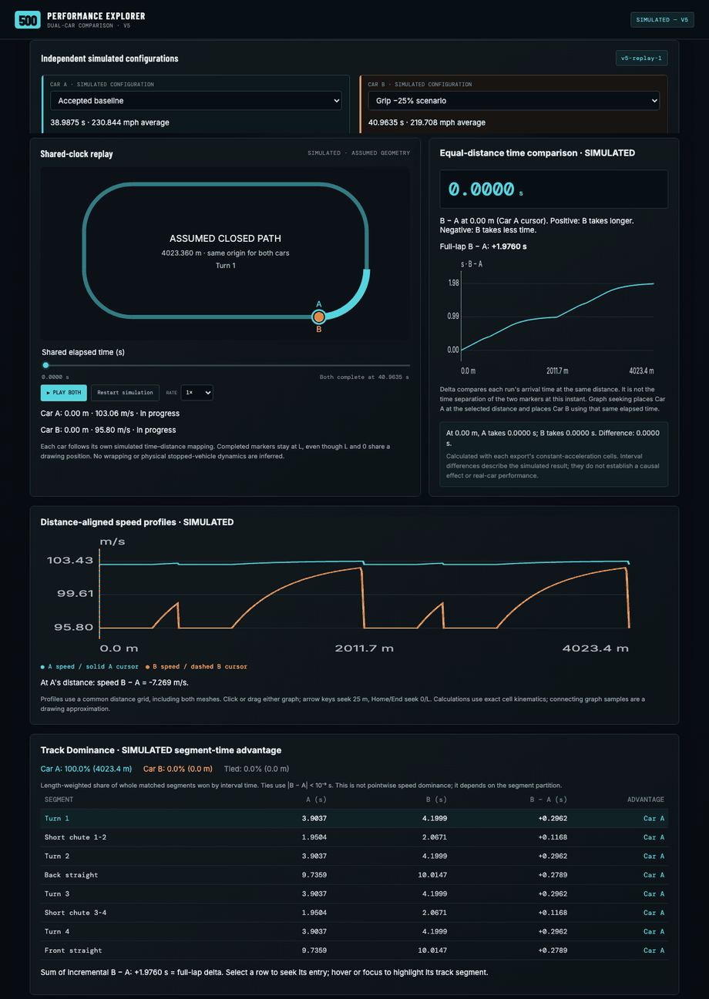
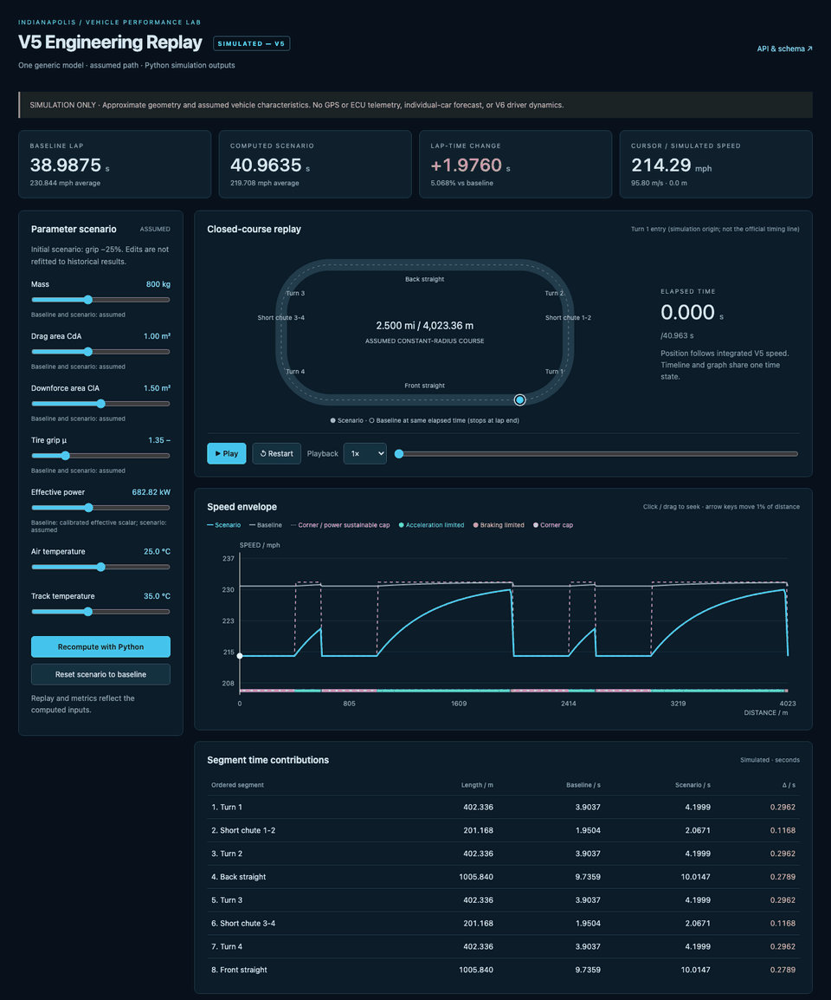
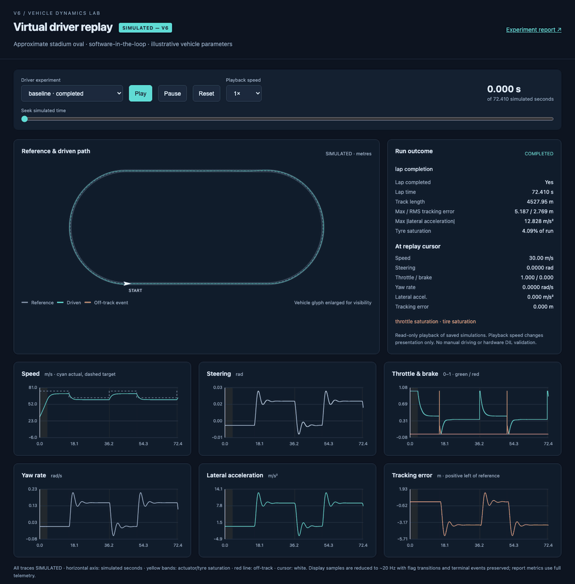
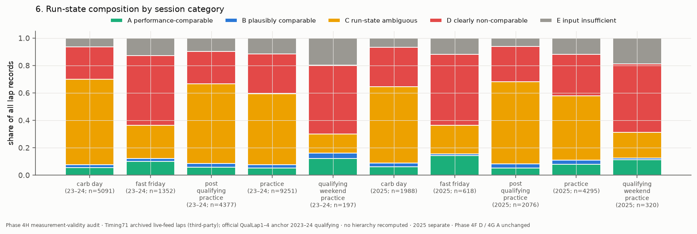
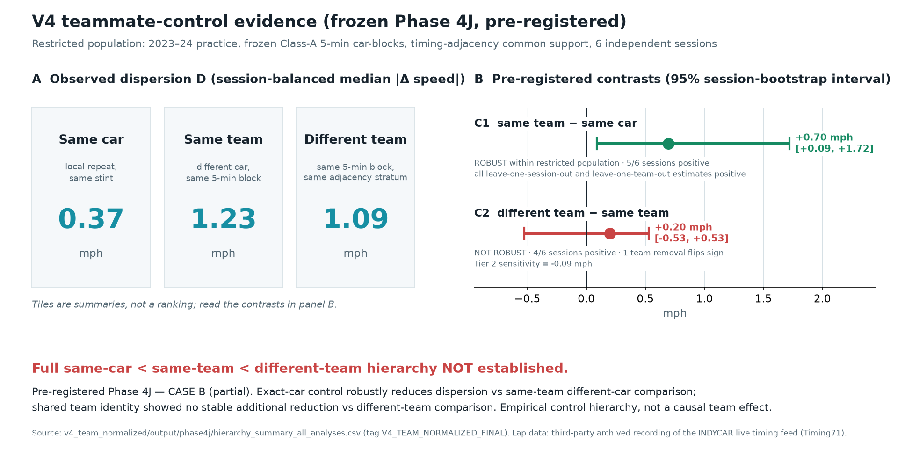

# Indy 500 — Evidence, Simulation & Performance Explorer

A motorsport engineering portfolio spanning point-in-time decision support, frozen scientific evidence, native C++17 computation, vehicle simulation and interactive replay. Python, FastAPI and React/TypeScript connect traceable data to engineering tools; Docker and GitHub Actions support reproducible delivery.

**Explore:** [V2](docs/final_v2_system_specification.md) / [V3](v3_point_in_time/README.md) · [V4](v4_team_normalized/README.md) · [V5](v5_lap_time_simulation/README.md) · [V6](v6_driver_in_loop/README.md) · [Performance Explorer](performance_explorer/README.md) · [C++17](cpp/README.md)

[](https://github.com/fengzhe-li/indy500-racing-point-in-time-decision-support/actions/workflows/ci.yml)
[](https://github.com/fengzhe-li/indy500-racing-point-in-time-decision-support/actions/workflows/explorer.yml)
[](https://github.com/fengzhe-li/indy500-racing-point-in-time-decision-support/actions/workflows/integrity.yml)



**SIMULATED — V5 · Performance Explorer.** Recorded from the real application: baseline versus grip −25%, synchronized playback and independent finish clamping. [Watch the MP4](docs/media/explorer-dual-car.mp4) · [Run the Explorer](performance_explorer/README.md).

## Find your module

| Module | What it provides | Documentation |
|---|---|---|
| **V2 / V3** | Frozen physical-response inference, forecast provenance, leakage checks, historical replay and evidence-aware abstention | [V2 specification](docs/final_v2_system_specification.md) · [V3 application](v3_point_in_time/README.md) |
| **V4** | Frozen study of team identity, measurement comparability and control evidence | [V4 README](v4_team_normalized/README.md) · [Final synthesis](v4_team_normalized/output/phase4l/phase4l_final_scientific_synthesis.md) |
| **V5** | Quasi-steady lap-time solver, numerical experiments and Python-backed engineering replay | [V5 README](v5_lap_time_simulation/README.md) |
| **V6** | Dynamic bicycle model, virtual driver, scenario sweeps and recorded telemetry | [V6 README](v6_driver_in_loop/README.md) |
| **Performance Explorer V1.1** | Historical timing, V5 comparison and integrated V6 dual-car replay in one interface | [Explorer README](performance_explorer/README.md) |
| **C++17** | Native temporal guards, forecast selection and physical-response calculations with Python parity checks | [C++17 README](cpp/README.md) |

## Performance Explorer — one interface, three domains

The unified React/TypeScript Explorer keeps three distinct evidence contracts:

- **Historical — OBSERVED:** 196 retained complete qualifying attempts from 2020–2024. Replay advances at recorded lap boundaries; continuous positions are unknown.
- **V5 — SIMULATED:** compare published/imported runs or two independently recomputed configurations, with speed overlays, equal-distance time delta and Track Dominance.
- **V6 — SIMULATED:** replay the completed baseline and off-track 600 ms delay scenario using the audited schema-2 adapter, synchronized telemetry and each car's actual terminal event.


**Integrated Explorer V1.1 — V6 mode.** This recording shows the accepted Explorer interface, including shared playback controls, telemetry and speed traces. [Watch the MP4](docs/media/explorer-v6-integrated.mp4) · [Setup and data contracts](performance_explorer/README.md).

```sh
cd performance_explorer/frontend
npm ci
npm run dev
```

Bundled replays work without a simulation server. V5 recomputation requires its Python service; see the [connection guide](performance_explorer/README.md#connect-the-v5-api). V6 V1.1 currently bundles two scenarios. V5 and V6 use different track geometries and are never compared through cross-mode lap times or Track Dominance.

## V5 — quasi-steady physics

A Python/NumPy model combines aero, banked tyre-force limits, power, braking and cornering on an assumed **4023.36 m** oval. Its separate engineering viewer supports scenario recomputation and replay from real solver exports.



**SIMULATED — V5 · Standalone engineering viewer.** Baseline **38.987453 s**; grip −25% **40.963472 s**. [Watch the MP4](docs/media/v5-physics-comparison.mp4) · [V5 setup, physics and validation](v5_lap_time_simulation/README.md).

The effective scalar is fitted on 2020–2023; the retrospective 2024 comparison does **not** outperform the training-median speed benchmark. Track shape and vehicle parameters remain assumptions, not identified individual-car measurements.

## V6 — vehicle dynamics and virtual driver

An audited dynamic bicycle model with RK4 integration, pure-pursuit steering and PID speed control produces actual simulated trajectories, actuator commands, yaw, acceleration and tracking errors. The scenario matrix contains **14 completed and 5 off-track runs**.



**SIMULATED — V6 · Standalone dynamics viewer.** Baseline completes in **72.409997 s**; the 600 ms delay run terminates off track at **17.474 s**. [Watch the MP4](docs/media/v6-vehicle-dynamics.mp4) · [V6 model, replay and robustness reports](v6_driver_in_loop/README.md).

This is software-in-the-loop with an illustrative virtual driver and an approximate **4527.95 m** stadium. It is not measured ECU telemetry, surveyed IMS geometry or validated hardware driver-in-the-loop performance. The standalone recording above is distinct from the integrated Explorer V6 recording.

## C++17 — native computation

The additive native engine implements UTC parsing, point-in-time guards, observation filtering, forecast-vintage selection, solar geometry and physical-response/Monte Carlo calculations. CMake, GoogleTest and optional pybind11 bindings support parity checks and a Python fallback.

Reported verification includes **16 C++ tests** and **12 Python parity/regression tests**. Component microbenchmarks are documented with their workloads and pre-parsed Python comparison; they are not end-to-end API speedups. Python remains the authoritative application implementation, and normal historical/scenario API requests do not execute the native engine. [Build, tests and benchmark details](cpp/README.md).

## V2 / V3 — point-in-time decision support

**FINAL_V2** freezes a physics-conditioned probabilistic response model over **41 same-car transitions**, with section evidence for **39/41** and calibrated horizons of **15 / 30 / 60 / 90 / 120 minutes**. **FINAL_V3_FROZEN** adds forecast provenance, a fail-closed information cutoff, read-only historical replay, a separate hypothetical scenario interface and FastAPI/React/Docker delivery.

The 2025 external evaluation contains **15 cases**: MAE **0.492 mph**, RMSE **0.610 mph**, and directional accuracy **46.7%**. Only **4** cases lie within the production horizon. Genuine point-in-time replay has **10 candidates** and **0 cases** supporting formal aggregate historical-scoring validation; the illustrative near-anchor case is not validation.

The system conditions on a supplied horizon and supports human judgement. It does not infer queue opportunity, team intent, or whether to retain or withdraw a qualifying result. Small samples, latent setup/tyre/execution state, thermal-regime transfer and forecast availability limit conclusions. [V2 specification](docs/final_v2_system_specification.md) · [V3 application](v3_point_in_time/README.md) · [Complete evidence and limitations](docs/PORTFOLIO_EVIDENCE.md).

## V4 — team-normalized evidence

**V4_TEAM_NORMALIZED_FINAL** is a frozen, additive study that preserves V2/V3. Across six independent 2023–24 sessions, observed dispersion is **0.37 mph** for the same car, **1.23 mph** for the same team, and **1.09 mph** for different teams.

- **C1 = same team − same car = +0.70 mph** [+0.09, +1.72]. Robust exact-car control benefit.
- **C2 = different team − same team = +0.20 mph** [−0.53, +0.53]. **Not robust:** the full three-level hierarchy was **not established**.
- Only **8.1%** of at-speed practice laps met the qualifying-calibrated Class-A rule. Of **113** teammate-assisted target events, only **8** strict leakage-free cases survived. This is **not** evidence that teammate predictive value is zero.

[Module documentation](v4_team_normalized/README.md) · [Scientific synthesis and limits](v4_team_normalized/output/phase4l/phase4l_final_scientific_synthesis.md).

## Scientific evidence and reproducibility

Historical observations, hypothetical inference and simulated trajectories remain separate. Frozen V2/V3/V4 coefficients, manifests, evidence and results are preserved. The full methodology, diagnostic figures, numerical tables, original verification records and detailed limitations remain available in the [extended evidence reference](docs/PORTFOLIO_EVIDENCE.md) and module documentation.

[Methodology](docs/methodology.md) · [Model card](docs/model-card.md) · [Validation](docs/validation.md) · [Data provenance](docs/evidence-engineering.md) · [Reproducibility](docs/reproducibility.md) · [Full report](docs/paper/physics_conditioned_probabilistic_performance_inference.pdf) · [Media provenance](docs/media/README.md)

```sh
python3 scripts/validate_portfolio.py
python3 -m unittest discover -s tests -p 'test_*.py' -v
```

## Scientific figures

The original research figures are displayed here on the repository homepage. Related architecture diagrams and application screens share two-column layouts; diagnostic, validation and scenario charts remain full-width for legibility. The extended evidence reference retains the complete interpretation, quantitative results, citations and scientific limitations.

### Point-in-time system and application

| Identifiability boundary | V3 application architecture |
|---|---|
|  |  |

| Pit-wall outlook | Scenario mode |
|---|---|
|  |  |

| Historical shadow replay | Validation and abstention |
|---|---|
|  |  |

### Evidence engineering and frozen physical response

| Evidence engineering pipeline | Evidence hierarchy |
|---|---|
|  |  |


| Same-car transition design | Frozen physical-response model |
|---|---|
|  |  |


### Future physical state and uncertainty

| Future track-state model | Three-source uncertainty architecture |
|---|---|
|  |  |


### Calibration, mechanism and scenario diagnostics


### External validation and technical-regime transfer


### V4 team-normalized evidence





### Operational outlook and reproducibility


See the [extended evidence reference](docs/PORTFOLIO_EVIDENCE.md) for the full methods, quantitative tables, citations, validation records and limitations.

**Author:** Fengzhe Li · Independent research and engineering project; not affiliated with INDYCAR or IMS. [Citation](CITATION.cff).
