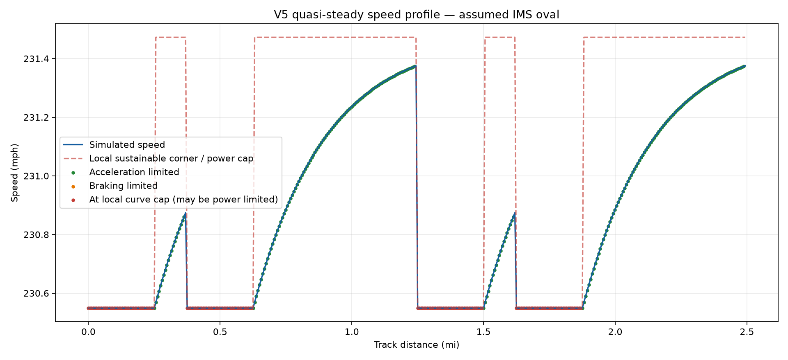
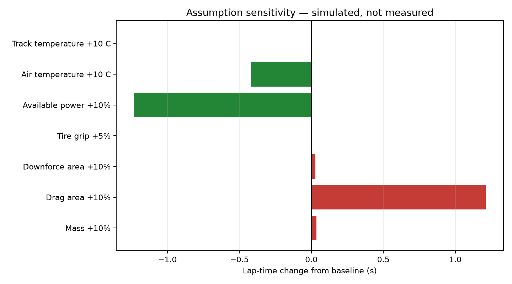
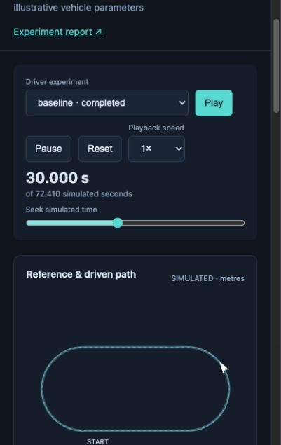

# Indy 500 — Point-in-Time Decision Support, Frozen Scientific Evidence & Vehicle Simulation Extensions

A full-stack motorsport research and software engineering repository anchored by a **frozen physics-conditioned probabilistic decision-support core (`V2`)**, a **leakage-controlled point-in-time replay and hypothetical scenario application (`V3`)**, a **pre-registered team-normalized evidence study (`V4`)**, and an **additive C++17 temporal and physical computation engine (`C++17`)**, extended with later vehicle-engineering simulation modules for **quasi-steady lap-time physics (`V5`)**, **Software-in-the-Loop vehicle dynamics and virtual-driver control (`V6`)**, and a **unified dual-car comparison interface (`Performance Explorer`)**.

**[V2](docs/final_v2_system_specification.md) | [V3](v3_point_in_time/README.md) | [V4](v4_team_normalized/README.md) | [V5](v5_lap_time_simulation/README.md) | [V6](v6_driver_in_loop/README.md) | [Performance Explorer](performance_explorer/README.md) | [C++17](cpp/README.md)**

**On this page:** [Module Navigation](#module-navigation--architecture-overview) · [V2 / V3 Core System](#v2--v3--scientific-model-and-point-in-time-application) · [V4 Team-Normalized Evidence](#v4--team-normalized-evidence) · [C++17 Native Computation](#c17--native-computation) · [Scientific & Application Figure Gallery (36 Figures)](#scientific-and-application-figure-gallery) · [V5 Lap-Time Physics Simulation](#v5--lap-time-physics-simulation) · [V6 Vehicle Dynamics & Virtual Driver](#v6--vehicle-dynamics-and-virtual-driver) · [Performance Explorer](#performance-explorer--unified-interface-and-demonstrations) · [Reproducibility, Limitations & Documentation](#reproducibility-limitations-and-further-documentation)

[](https://github.com/fengzhe-li/indy500-racing-point-in-time-decision-support/actions/workflows/ci.yml)
[](https://github.com/fengzhe-li/indy500-racing-point-in-time-decision-support/actions/workflows/explorer.yml)
[](https://github.com/fengzhe-li/indy500-racing-point-in-time-decision-support/actions/workflows/integrity.yml)

---

## Module Navigation & Architecture Overview

**[V2](docs/final_v2_system_specification.md)**, **[V3](v3_point_in_time/README.md)**, and **[V4](v4_team_normalized/README.md)** constitute the repository's central scientific and point-in-time decision-support work, backed by an additive **[C++17](cpp/README.md)** computational engine. **[V5](v5_lap_time_simulation/README.md)**, **[V6](v6_driver_in_loop/README.md)**, and the **[Performance Explorer](performance_explorer/README.md)** are later, isolated vehicle-engineering simulation extensions that preserve all frozen scientific assets without modification.

| Module | Role & Evidence Class | Core Scientific or Engineering Scope | Stack & Verification | Module README & Section |
|---|---|---|---|---|
| **[V2](docs/final_v2_system_specification.md) / [V3](v3_point_in_time/README.md)** | Core Scientific Model & Application (`FINAL_V2` / `FINAL_V3_FROZEN`) | Physics-conditioned probabilistic performance inference $p(\Delta v \mid H = h)$ over `41` same-car transitions (`39/41` section-linked, `15/30/60/90/120 min` horizons), HRRR forecast-vintage provenance, fail-closed `issue_time <= decision_time` leakage guard, read-only shadow replay, isolated Scenario Mode, and hardened Docker containers | Python · FastAPI · React/TypeScript · Docker (`read_only: true`, non-root) · `101/101` V3 tests | [V2 Spec](docs/final_v2_system_specification.md) · [V3 README](v3_point_in_time/README.md) · [Jump to Section ↓](#v2--v3--scientific-model-and-point-in-time-application) |
| **[V4](v4_team_normalized/README.md)** | Core Additive Evidence Study (`V4_TEAM_NORMALIZED_FINAL`) | Rule-based entity resolution (`59` entrant labels → `21` canonical engineering teams, `2018–2025`), practice run-state comparability audit (`8.1%` Class-A), and pre-registered `same car < same team < different team` dispersion hierarchy tests (`Phase 4H/4J/4K/4L`) | Python · `735`-file SHA-256 freeze manifest · `17/17` Phase 4L checks | [V4 README](v4_team_normalized/README.md) · [Final Synthesis](v4_team_normalized/output/phase4l/phase4l_final_scientific_synthesis.md) · [Jump to Section ↓](#v4--team-normalized-evidence) |
| **[C++17](cpp/README.md)** | Additive Native Compute (`indy500_pit_engine`) | Native C++17 ISO-8601 UTC parsing, fail-closed point-in-time guards, timestamp-aware observation lookback filtering, HRRR forecast-vintage store, NOAA solar geometry, and `M2b`/Monte Carlo evaluation with transparent Python fallback | C++17 · CMake · GoogleTest (`16/16`) · `pybind11` parity suite (`12/12`) | [C++17 README](cpp/README.md) · [`pit_engine.hpp`](cpp/include/indy500/pit_engine.hpp) · [Jump to Section ↓](#c17--native-computation) |
| **[V5](v5_lap_time_simulation/README.md)** | Vehicle Simulation Extension (`SIMULATED — V5`) | Quasi-steady closed-loop spatial speed solver on an assumed `4023.360 m` (`2.5 mi`, `9.2°` banked) 8-segment oval, spatial mesh convergence audit (`40 m` to `1.25 m`), sensitivity sweeps, retrospective 2024 comparison, and FastAPI + React replay viewer | Python · NumPy · FastAPI · React/TypeScript (`v5-replay-1` schema, `25/25` Python tests) | [V5 README](v5_lap_time_simulation/README.md) · [Physics Model](v5_lap_time_simulation/docs/PHYSICS_MODEL.md) · [Jump to Section ↓](#v5--lap-time-physics-simulation) |
| **[V6](v6_driver_in_loop/README.md)** | Vehicle Dynamics Extension (`SIMULATED — V6`) | Audited planar dynamic-bicycle Software-in-the-Loop (SIL) simulator with classical RK4 integration, circular combined-slip tyre saturation, pure-pursuit + anti-windup PID virtual driver, `≤1 ns` boundary/finish bisection, 19-scenario robustness matrix (`14` completed / `5` off-track), and standalone Canvas telemetry viewer | Python 3.10+ stdlib · ES Modules / HTML5 Canvas (`44` Python + `9` JS tests) | [V6 README](v6_driver_in_loop/README.md) · [Vehicle Dynamics](v6_driver_in_loop/docs/VEHICLE_DYNAMICS.md) · [Jump to Section ↓](#v6--vehicle-dynamics-and-virtual-driver) |
| **[Performance Explorer](performance_explorer/README.md)** | Unified Comparison UI (`OBSERVED` + `SIMULATED V5/V6`) | Unified React/TypeScript dual-car comparison application separating `196` official historical qualifying attempts (`OBSERVED`), V5 dual-car simulation overlays (`SIMULATED — V5`), and integrated V6 schema-2 dynamic telemetry replay (`SIMULATED — V6`) | React 18 · TypeScript · Vite · Vitest · Python data audit & integrity suite | [Explorer README](performance_explorer/README.md) · [Data Contract](performance_explorer/docs/DATA_CONTRACT.md) · [Jump to Section ↓](#performance-explorer--unified-interface-and-demonstrations) |

---

## V2 / V3 — Scientific Model and Point-in-Time Application

During Indianapolis 500 qualifying, an entrant with a valid four-lap average must decide whether to hold position in the lower-priority lane or withdraw that official time to seek priority for another attempt as track and ambient conditions evolve. Because public historical records do not consistently expose queue entry, Lane 1/Lane 2 state, withdrawals, or team intent, **[V2 (`FINAL_V2`)](docs/final_v2_system_specification.md)** and **[V3 (`FINAL_V3_FROZEN`)](v3_point_in_time/README.md)** enforce an explicit **identifiability boundary**: the system estimates the conditional physical performance distribution $p(\Delta v \mid H = h)$ for a same-car repeat attempt at a supplied horizon $h$, while leaving unobservable queue timing $P(H = h)$ and final retain/withdraw strategy judgement to the human pit wall.

### Frozen Scientific Core ([V2 Specification](docs/final_v2_system_specification.md))

- **Canonical Evidence & Observational Units ([`pipeline/`](pipeline/run_pipeline.py), [`docs/evidence-engineering.md`](docs/evidence-engineering.md)):** Reconciles `329` qualifying attempts, `1,174` laps, and `9,898` section rows (`2020–2024`) with `133,138` field-level provenance links (`field_evidence_links.csv`) and `12,998` target-specific eligibility evaluations. The performance core uses **41 same-car within-day transitions**; section mechanism diagnostics link to **39/41 transitions** (`351` dependent within-transition section comparisons, never treated as independent training rows); and the future track-state pathway uses **168 structured track-temperature observations** forming **656 current–future pairs** across five independently calibrated horizons (**`15 / 30 / 60 / 90 / 120 minutes`**).
- **Zero-Intercept Physical Response (`r5_2/manual/probabilistic_physics_core_v1.json`):**
  $$\Delta v_{\text{physical}} = \beta_{\text{track}}\,\Delta T_{\text{track}} + \beta_{\text{ambient}}\,\Delta T_{\text{ambient}}, \qquad \beta_{\text{track}} = -0.034825\text{ mph/}^\circ\text{C},\quad \beta_{\text{ambient}} = +0.182393\text{ mph/}^\circ\text{C}$$
  The zero intercept ensures that zero measured thermal change predicts zero modelled thermal effect while preserving latent tyre, setup, wind, and driver execution variation in the empirical residual distribution.
- **Future Track-State (`M2b_mean_solar`) & Three-Source Uncertainty ([`docs/uncertainty.md`](docs/uncertainty.md)):** Horizon-specific future track temperature conditions on future ambient change, current track-to-ambient thermal gap, and mean solar elevation. Predictive distributions propagate (1) paired-bootstrap coefficient uncertainty, (2) horizon-specific conformal future track-temperature intervals, and (3) centered leave-one-year-out empirical performance residuals. Removing empirical performance residuals reduces mean 80% interval width by **`90.4%` at 15 minutes** and **`72.8%` at 120 minutes**, showing why better track-temperature point prediction alone cannot collapse outcome uncertainty.
- **Diagnostics & 135-Scenario Stress Test:** Mean directional coherence across nine track sections is **`0.724`** overall (`n = 39`) and rises to **`0.935`** for transitions with $|\Delta v| \ge 0.50\text{ mph}$ (`n = 12`). Historical fixed-point/gridded wind proxies showed weak out-of-year residual stability and were not forced into `FINAL_V2`. Exercised across **135 scenarios** (`3 thermal gaps × 3 ambient trajectories × 3 solar states × 5 horizons`), 120-minute $P(\Delta v > 0)$ ranges from **`0.20552` to `0.6704`** (`[0.20552, 0.6704]`) and expected $\Delta v$ ranges from **`−0.4630` to `+0.2248 mph`**.

| Scientific / Validation Dimension | Verified Value | Engineering & Statistical Interpretation |
|---|---:|---|
| **Frozen same-car transitions (`2020–2024`)** | **`41`** (`39 / 41` section-linked) | High-confidence exact-car repeat performance core (`32/32` frozen files SHA-256 verified) |
| **Future track-state sample interface** | **`656` pairs** (`15 / 30 / 60 / 90 / 120 min`) | Horizon-specific `M2b_mean_solar` fits; `OPERATIONAL_CURVE_V2` labels 1-min intermediate steps as `INTERPOLATED_OPERATIONAL` |
| **Systematic physical stress test** | **`135` scenarios** | At `120 min`, $P(\Delta v > 0) \in [0.20552, 0.6704]$ and $E[\Delta v] \in [-0.4630, +0.2248]\text{ mph}$ |
| **2025 external hybrid-era evaluation (`≤180 min`)** | **`15` cases** (`MAE = 0.492 mph`, `RMSE = 0.610 mph`) | `80% / 90%` PI coverage: **`80% / 100%`**; directional accuracy: **`46.7%`** (`0.466667`, weak direction discrimination reported transparently) |
| **2025 production-horizon subset (`≤120 min`)** | **`4` cases** (`MAE = 0.221 mph`, `RMSE = 0.269 mph`) | `80% / 90%` PI coverage: `100% / 100%`; directional accuracy: `50.0%` (sample too small for broad calibration claims) |
| **V3 point-in-time historical shadow replay** | **`10` candidates → `0` formal scoring cases** | `31/41` pre-candidates excluded for timestamp ambiguity; `9/10` candidates have realized horizon `>120 min`; `1` case (2021 Car 60) is illustrative only |

### Point-in-Time Application Layer ([V3 README](v3_point_in_time/README.md))

**[V3 (`FINAL_V3_FROZEN`)](v3_point_in_time/README.md)** wraps the immutable `FINAL_V2` core in a production FastAPI + React/TypeScript application ([`v3_point_in_time/`](v3_point_in_time/README.md)) with two strictly isolated execution paths:

1. **Historical Shadow Replay & Evidence-Aware Abstention:** A vintage-aware HRRR forecast store (`ForecastVintageStore`) and fail-closed temporal guard (`point_in_time_guard.py`) enforce `known_at <= decision_time` and `forecast.issue_time <= decision_time`. When timestamp granularity or horizon support is insufficient, the engine returns structured machine-readable abstention reason codes (`INSUFFICIENT_ATTEMPT_TIMESTAMP`, `HORIZON_OUT_OF_SUPPORT`, `NON_ANCHOR_EVALUATION_NOT_APPROVED`). The single near-anchor case (`2021, Car 60`) is retained strictly as `ILLUSTRATIVE_POINT_IN_TIME_SHADOW_CASE` (where forecast-conditioned `+0.0236 mph` and realized-weather `+0.0451 mph` expectations both differed from the `+4.695 mph` observed jump) and is never counted as validation.
2. **Isolated Hypothetical Scenario Mode & Hardened Runtime:** `POST /api/scenario/infer` evaluates user-supplied physical states through the identical frozen `FINAL_V2` adapter, badges every response `HYPOTHETICAL_SCENARIO` / `NOT_HISTORICAL_EVIDENCE`, and is AST-verified never to write to historical stores. Docker deployment mounts a kernel-enforced `read_only: true` root filesystem under a non-root user (`uid 10001`).

```bash
# Launch the FINAL_V3 FastAPI backend (http://127.0.0.1:8000) and React UI (http://127.0.0.1:5173)
./v3_point_in_time/scripts/run_v3_app.sh
```

Read more: [V2 System Specification](docs/final_v2_system_specification.md) · [V3 Application README](v3_point_in_time/README.md) · [V3 Architecture](v3_point_in_time/output/final_documentation/final_v3_architecture.md) · [V3 Model Card](v3_point_in_time/output/final_documentation/FINAL_V3_MODEL_CARD.md) · [Extended Portfolio Evidence Reference](docs/PORTFOLIO_EVIDENCE.md).

---

## V4 — Team-Normalized Evidence

**[V4 (`V4_TEAM_NORMALIZED_FINAL`)](v4_team_normalized/README.md)** is a separately frozen, additive methodological investigation (`735`-file SHA-256 manifest, `17/17` Phase 4L checks passing) that asks whether same-team, different-car observations can provide an intermediate control layer between exact-car repeats and unrelated cars without altering any `FINAL_V2` or `FINAL_V3_FROZEN` artifact:

- **Canonical Team Entity Resolution (`2018–2025`, [`v4_build_team_registry.py`](v4_team_normalized/scripts/v4_build_team_registry.py)):** Deterministic rule-based normalization (`51` explicit rules, no fuzzy matching) maps `59` official entrant labels to **21 canonical engineering teams**, recovering `85` of `313` true teammate relationships (`27%`) missed by raw entrant labels while introducing zero false pairs.
- **Practice Measurement Validity (`Phase 4H`):** Auditing third-party archived live-timing practice laps (`Timing71`, cross-checked against official INDYCAR session records for `2023–2025`) shows that only **8.1%** of at-speed 2023–2024 practice laps satisfied the frozen, qualifying-calibrated Class-A performance-comparability rule. Raw practice laps cannot be treated as a homogeneous performance population.
- **Pre-Registered Dispersion Hierarchy Test (`Phase 4J`, Primary Tier-1 `2023–2024` across 6 independent sessions):** Within Class-A 5-minute car-blocks sharing timing-adjacency common support, session-balanced median $|\Delta\text{speed}|$ dispersion is **0.37 mph** for the same car, **1.23 mph** for the same team, and **1.09 mph** for different teams:
  - **C1 = same team − same car = +0.70 mph** [+0.09, +1.72]. **Robust** exact-car control benefit (positive in `5/6` sessions and every leave-one-session-out and leave-one-team-out check).
  - **C2 = different team − same team = +0.20 mph** [−0.53, +0.53]. **Not robust:** positive in `4/6` sessions, one team removal flips its sign, and Tier-2 sensitivity yields `−0.09 mph`. The full three-level hierarchy (*same car < same team < different team*) was **not established** (`PRIMARY_CASE = B`).
- **Prospective Teammate-Assisted Attrition (`Phase 4K`):** Of **113** teammate-assisted target events (`F0`), only **8** strict leakage-free cases (`F5`) survived point-in-time and comparability filtering. Teammate predictive value remains prospectively unidentifiable from the current retrospective record; this is **not** evidence that teammate predictive value is zero.

Read more: [V4 Workspace README](v4_team_normalized/README.md) · [Phase 4L Final Scientific Synthesis](v4_team_normalized/output/phase4l/phase4l_final_scientific_synthesis.md) · [Claims Matrix](v4_team_normalized/output/phase4l/phase4l_claims_matrix.csv) · [Evidence Chain](v4_team_normalized/output/phase4l/phase4l_evidence_chain.md).

---

## C++17 — Native Computation

While Python remains the authoritative application implementation for historical ingestion, replay orchestration, and FastAPI serving, **[C++17 (`cpp/`)](cpp/README.md)** provides an additive native computational module (`indy500_pit_engine`) reimplementing the inner-loop point-in-time temporal guards, observation lookback filtering, forecast-vintage selection, and physical-response calculations with GoogleTest verification and optional `pybind11` bindings (`_indy500_pit_cpp`).

- **Implemented Components ([`pit_engine.hpp`](cpp/include/indy500/pit_engine.hpp), [`pit_engine.cpp`](cpp/src/pit_engine.cpp)):**
  1. **ISO-8601 UTC parsing & fail-closed leakage guard** (`parse_iso8601_utc`, `check_point_in_time`, `enforce_point_in_time`): Proleptic Gregorian epoch conversion enforcing `known_at <= decision_time` and `forecast.issue_time <= decision_time` (rejecting records even `1 s` after `decision_time` with reason codes identical to Python).
  2. **Timestamp-aware observation filtering & thermal rate lookback** (`filter_observations_at_cutoff`, `compute_point_in_time_thermal_rate`): Deterministic sorting of arbitrary input permutations by `(observed_at, known_at, id)`, strict `NaN`/`Inf`/duplicate rejection, and 10–20 minute track heating/cooling rate calculation (`°C/min`).
  3. **Vintage-aware HRRR selection & domain physics** (`ForecastVintageStore`, `solar_elevation_deg`, `evaluate_applicability`, `evaluate_physical_response`, `summarize_draws`, `run_monte_carlo_inference`): Exact `1e-12` numerical parity with `FINAL_V2` across all **656** frozen rows in `future_track_samples_with_solar_v1.csv` and all **259** HRRR forecast vintages.
- **Verification & Component Microbenchmarks ([`cpp/README.md`](cpp/README.md)):**
  - **16/16 C++ GoogleTest tests PASS** and **12/12 Python↔C++ parity and fallback tests PASS** ([`test_cpp_engine_parity.py`](v3_point_in_time/tests/test_cpp_engine_parity.py)).
  - Measured component microbenchmarks (macOS arm64, Apple clang `-O3`, median of 9 warm runs): `solar_elevation_deg` (`6,560` calls) runs in **`0.87 ms` direct / `5.04 ms` via bridge** vs. `10.49 ms` Python (**`12.1×` / `2.1×`**); `ForecastVintageStore` (`259`-row init + `100` queries) runs in **`0.224 ms`** vs. `6.68 ms` unmodified Python / `0.88 ms` pre-parsed Python (**`29.8×` / `3.9×`**); `check_point_in_time` (`10,000` evaluations) runs in **`2.45 ms`** vs. `12.01 ms` (**`4.9×`**).
  - **Production path caveat:** These are component microbenchmarks, not end-to-end API speedups. The C++ engine is not executed in the production FastAPI historical replay or scenario request paths.

---

## Scientific and Application Figure Gallery

All **36 original scientific and application figures** are preserved directly below on the repository homepage. Paired diagrams, UI views, and single-panel plots with matched aspect ratios are arranged in compact two-column tables, while multi-panel or text-dense diagnostic charts remain full-width for clear legibility. Complete narrative context is cross-referenced in [`docs/PORTFOLIO_EVIDENCE.md`](docs/PORTFOLIO_EVIDENCE.md) and [`figures/GALLERY.md`](figures/GALLERY.md).

### 1. Point-in-Time System Boundary, V3 Architecture & Application Screens (Figures 1–6)

| Figure 1 — Identifiability-Driven System Boundary (`16:9`) | Figure 2 — V3 Historical Shadow Replay UI (`16:10`) |
|---|---|
|  |  |
| Separates the identifiable conditional physical response $p(\Delta v \mid H = h)$ from unobservable queue mechanics $P(H = h)$ and pit-wall utility decisions. | Time-ordered replay events enforcing the `known_at <= decision_time` and `forecast.issue_time <= decision_time` information cutoff boundary. |

| Figure 3 — V3 Pit-Wall Outlook UI (`01_pit_wall_outlook.png`) | Figure 4 — V3 Validation & Abstention UI (`05_validation_abstention.png`) |
|---|---|
|  |  |
| Conditional physical outlook across all five calibrated horizons (`15 / 30 / 60 / 90 / 120 min`) for the deterministically selected non-illustrative default case. | Authoritative evidence attrition (`41` transitions → `10` point-in-time candidates → `0` formal aggregate scoring cases) and abstention-reason breakdown. |

| Figure 5 — `FINAL_V3` Dual-Path Application Architecture | Figure 6 — V3 Hypothetical Scenario Mode UI (`02_scenario_mode.png`) |
|---|---|
|  |  |
| Architectural isolation between the read-only historical replay path and the ephemeral hypothetical scenario path sharing the unmodified `FINAL_V2` adapter. | Isolated hypothetical scenario inference explicitly badged `HYPOTHETICAL SCENARIO — NOT HISTORICAL EVIDENCE` and blocked from writing to historical stores. |

### 2. Evidence Engineering, Data Provenance & Frozen Physical Response (Figures 7–14)

| Figure 7 — Evidence Engineering Pipeline (`16:9`) | Figure 8 — Canonical Evidence Products & Attrition (`16:9`) |
|---|---|
|  |  |
| Source-registry ingestion, canonical reconciliation (`329` attempts, `1,174` laps, `9,898` sections), and field-level provenance (`133,138` links). | Target-specific eligibility filtering across `12,998` evaluations and explicit quarantine of unresolved chronology or weather joins. |

| Figure 9 — Multi-Layer Evidence Hierarchy (`16:9`) | Figure 10 — Exact-Car Repeat Transition Design (`16:9`) |
|---|---|
|  |  |
| Distinct observational units across `41` same-car transitions, `39` section-linked transitions (`351` within-transition pairs), and `656` track-state pairs. | Within-day same-car qualifying repeat design controlling for chassis, engine, baseline aerodynamic package, and driver identity (`2020–2024`). |

| Figure 11 — Frozen Zero-Intercept Physical Response (`16:9`) | Figure 12 — Calibrated Horizon & Operational Boundary (`16:9`) |
|---|---|
|  |  |
| Huber-robust zero-intercept thermal response: $\beta_{\text{track}} = -0.034825\text{ mph/}^\circ\text{C}$ and $\beta_{\text{ambient}} = +0.182393\text{ mph/}^\circ\text{C}$. | Scientific calibration at exact `15, 30, 60, 90, 120 min` anchors; intermediate 1-minute points are labelled `INTERPOLATED_OPERATIONAL`. |

| Figure 13 — Physical-State Transition Examples | Figure 14 — Observed vs. Frozen Physical Prediction |
|---|---|
|  |  |
| Measured $\Delta T_{\text{track}}$ and $\Delta T_{\text{ambient}}$ examples showing the gap between modelled physical contribution and total realized speed change. | Observed four-lap speed change versus frozen deterministic physical prediction, illustrating why empirical attempt-level residuals must be propagated. |

### 3. Future Track-State Pathway, Probabilistic Uncertainty & LOYO Stability (Figures 15–21)

| Figure 15 — Future Track-State Model (`M2b_mean_solar`) | Figure 16 — Three-Source Uncertainty Architecture |
|---|---|
|  |  |
| Horizon-specific future track-temperature specification conditioning on future ambient change, current thermal gap, and mean solar elevation (`656` pairs). | Monte Carlo combination of paired-bootstrap coefficient draws, conformal future track-temperature intervals, and centered LOYO attempt residuals. |

| Figure 17 — Future Track Candidate-Model Selection | Figure 18 — Future Track Conformal Calibration |
|---|---|
|  |  |
| Leave-one-year-out structural and solar-feature MAE comparisons across `611` common samples and validated horizons, selecting `M2b_mean_solar`. | Overall empirical conformal coverage (`0.806` at 80%, `0.908` at 90%) versus the `2022` thermal-regime shift undercoverage warning (`0.610` / `0.699`). |


*Above — **Figure 19 (`uncertainty-source-ablation.png`):** Two-panel uncertainty-source ablation across horizons (`15–120 min`), showing that removing empirical attempt-level performance residuals compresses 80% predictive interval width by **`90.4%` at 15 minutes** and **`72.8%` at 120 minutes**.*

| Figure 20 — LOYO Track Coefficient Stability ($\beta_{\text{track}}$) | Figure 21 — LOYO Ambient Coefficient Stability ($\beta_{\text{ambient}}$) |
|---|---|
|  |  |
| Leave-one-year-out refits of $\beta_{\text{track}}$ (`−0.0292` to `−0.0456 mph/°C`) against the frozen full-sample value (`−0.034825 mph/°C`). | Leave-one-year-out refits of $\beta_{\text{ambient}}$ across held-out reference seasons against the frozen full-sample value (`+0.182393 mph/°C`). |

### 4. Mechanism Diagnostics & 135-Scenario Physical Stress Tests (Figures 22–26)

| Figure 22 — Section-Level Mechanism Coherence (`39/41`) | Figure 23 — Historical Wind Residual Diagnostic |
|---|---|
|  |  |
| Mean directional coherence across nine track sections rises from `0.724` (`n = 39` all linked transitions) to `0.935` (`n = 12` transitions with $|\Delta v| \ge 0.50\text{ mph}$). | Partial Spearman correlations of fixed-point and gridded wind proxies with performance residuals remained too weak/unstable for a deterministic production term. |


*Above — **Figure 24 (`scenario-stress-test-120min.png`):** Three-panel 120-minute heatmap from the `135`-scenario physical stress test (`3 thermal-gap states × 3 ambient trajectories × 3 solar states`), where Monte Carlo $P(\Delta v > 0)$ spans **`0.20552` (`0.206`) to `0.6704` (`0.670`)**.*

| Figure 25 — Scenario Improvement-Probability Range by Horizon | Figure 26 — Scenario Expected-Performance Envelope by Horizon |
|---|---|
|  |  |
| Minimum, median, and maximum $P(\Delta v > 0)$ across all `27` physical scenarios at each calibrated horizon (`15–120 min`). | Expected speed-change envelope $E[\Delta v]$ across horizons (`−0.4630` to `+0.2248 mph` at `120 min`) under cooling, neutral, and warming trajectories. |

### 5. 2025 External Validation, Technical-Regime Transfer & V4 Team-Normalized Evidence (Figures 27–31)


*Above — **Figure 27 (`external-validation-2025.png`):** Case-by-case retrospective physical evaluation of the frozen `2020–2024` core on **`15` eligible 2025 hybrid-era same-car repeats** (`MAE = 0.492 mph`, `RMSE = 0.610 mph`, `80% PI = 80.0%`, `90% PI = 100.0%`, `directional accuracy = 46.7%`; `4` cases within `≤120 min` have `MAE = 0.221 mph`).*

| Figure 28 — Technical-Regime Timeline (`2019–2026`) | Figure 29 — Cross-Regime Thermal Coefficient Comparison |
|---|---|
|  |  |
| Technical and format evolution across `2019` pre-Aeroscreen, `2020–2024` frozen Aeroscreen reference, `2025` hybrid era, and `2026` format boundary. | 90% cluster-bootstrap intervals for `2019` (`n = 10`) and `2025` (`n = 23`) versus the frozen `2020–2024` point estimates (`n = 41`), showing directional compatibility. |


*Above — **Figure 30 (`fig06_run_state_by_session_category.png`):** V4 Phase 4H practice run-state audit across 10 session categories (`2023–2024` and `2025`), showing that only **`8.1%`** of 2023–2024 at-speed practice laps meet the qualifying-calibrated Class-A comparability criterion (green).*


*Above — **Figure 31 (`v4-control-evidence-summary.png`):** V4 Phase 4J pre-registered dispersion summary across 6 independent 2023–2024 sessions: same-car **`0.37 mph`**, same-team **`1.23 mph`**, and different-team **`1.09 mph`** (`C1 = +0.70 mph [+0.09, +1.72]` robust; `C2 = +0.20 mph [−0.53, +0.53]` not robust; full three-level hierarchy **not established**).*

### 6. Operational Decision-Support Overlays & Freeze Discipline (Figures 32–36)

| Figure 32 — Operational Performance Outlook (`OPERATIONAL_CURVE_V2`) | Figure 33 — Operational Improvement-Probability Outlook |
|---|---|
|  |  |
| Calibrated scientific anchors (`15, 30, 60, 90, 120 min`) connected by explicitly labelled 1-minute `INTERPOLATED_OPERATIONAL` expected $\Delta v$ and 80% PI bands. | Operational $P(\Delta v > 0)$ trajectories under cooling, neutral, and warming ambient paths across `0–120 min`. |

| Figure 34 — External Opportunity-Window Performance Overlay | Figure 35 — External Opportunity-Window Probability Overlay |
|---|---|
|  |  |
| Externally supplied pit-wall opportunity window (`45–75 min`) overlaid onto the physical performance curve without predicting queue duration. | Externally supplied opportunity window overlaid onto the improvement-probability trajectory to support human pit-wall decision-making. |


*Above — **Figure 36 (`freeze-and-reproducibility.svg`):** SHA-256 manifest governance across `FINAL_V2`, `R6_REGULATION_AWARE_EXTENSION_V1_FROZEN`, `FINAL_V3_FROZEN`, and `V4_TEAM_NORMALIZED_FINAL`, keeping all scientific artifacts immutable while isolating the later [V5](v5_lap_time_simulation/README.md), [V6](v6_driver_in_loop/README.md), and [Performance Explorer](performance_explorer/README.md) engineering extensions below.*

---

## V5 — Lap-Time Physics Simulation

**[V5 (`v5_lap_time_simulation/`)](v5_lap_time_simulation/README.md)** is an isolated vehicle-engineering extension that implements a Python/NumPy quasi-steady spatial lap-time solver together with a FastAPI service and React/TypeScript engineering replay viewer. It models aerodynamic drag and downforce, banked normal and lateral tyre-force limits, longitudinal friction-circle coupling, drivetrain power limits, and forward/backward integration passes around an explicitly assumed **`4023.360 m` (`2.5 mi`)** eight-segment closed oval.

### Standalone V5 Engineering Replay (`SIMULATED — V5`)


*Above — **`SIMULATED — V5` Standalone Engineering Viewer ([`v5_lap_time_simulation/`](v5_lap_time_simulation/README.md)):** Recorded from the verified Python solver exports (`v5_lap_time_simulation/output/replay.json` vs. `replay_low_grip.json`). Compares the recalibrated baseline (**`38.987453 s`**, **`230.843500 mph`** average speed, effective power scalar **`682.824947 kW`**, $\mu = 1.80$) against a **`-25%` tire-grip perturbation** (**`40.963472 s`**, **`219.708 mph`**, $\mu = 1.35$, **`+1.976019 s` / `+5.068346%`** lap delta), showing synchronized ghost-car progression, acceleration/braking regime shading, and 8-segment time contributions (`+0.296197 s` per turn, `+0.116753 s` per short chute, `+0.278862 s` per main straight). [**Watch full-resolution MP4 (`v5-physics-comparison.mp4`) →**](docs/media/v5-physics-comparison.mp4) · [**V5 module README →**](v5_lap_time_simulation/README.md)*

### V5 Spatial Speed Profile, Sensitivity Analysis & Retrospective 2024 Benchmark



*Above — **V5 Spatial Quasi-Steady Speed Profile (`v5_lap_time_simulation/output/speed_profile.png`):** Simulated speed (`230.548823–231.375288 mph`) across the assumed `4023.360 m` (`2.5 mi`) oval (`2 × 1005.840 m` main straights, `2 × 201.168 m` short chutes, `4 × 402.336 m` turns at $R = 256.135\text{ m}$ and $9.2^\circ$ banking). After auditing and correcting the legacy mixed flat/banked normal-load equations (increasing turn normal load from `16,682.434 N` to `21,553.986 N` and lowering lateral tire utilization at the legacy reference speed from `103.572%` to `75.899%` while reserving longitudinal tire capacity against aerodynamic drag), the baseline car remains **power-limited** below its sustainable cornering cap across all four turns. Reducing grip by `25%` ($\mu = 1.35$) drops the cornering speed cap below straightaway speed and activates explicit braking entry and acceleration exit zones.*

| Single-Factor Parameter Sensitivity (`sensitivity.png`) | Retrospective 2024 Descriptive Comparison (`historical_comparison.png`) |
|---|---|
|  |  |
| **Assumed-Model Perturbation Sensitivity:** One-factor perturbations around the `38.987453 s` baseline holding the calibrated `682.824947 kW` power scalar fixed: available power `+10%` (`-1.232977 s` / `-3.162%`), drag area $C_dA$ `+10%` (`+1.212310 s` / `+3.109%`), air temperature `+10 °C` (`-0.419448 s` / `-1.076%` via lower air density $\rho$), mass `+10%` (`+0.036528 s`), downforce area $C_lA$ `+10%` with $C_dA$ fixed (`+0.028116 s` via higher rolling resistance in a power-limited regime), and tire grip `+5%` or track temperature `+10 °C` (`0.000000 s` because baseline corners have unused lateral grip margin). | **Retrospective 2024 Benchmark (`54` Complete Attempts):** Calibrating one global power scalar (`682.825 kW`) to the `206`-attempt `2020–2023` pooled median speed (**`230.843500 mph`**) yields a constant prediction across all `54` complete 2024 qualifying attempts. The resulting 2024 speed MAE (**`1.142815 mph`**) and RMSE (**`1.400540 mph`**)—and four-lap time MAE (`0.769258 s`) / RMSE (`0.944403 s`)—**identically match the training-median constant-speed benchmark**, confirming zero aggregate predictive gain over the training median. |

### V5 Verification, Mesh Convergence & Setup

- **Spatial Mesh Refinement ([`ENGINEERING_RESULTS.md`](v5_lap_time_simulation/docs/ENGINEERING_RESULTS.md)):** Tested across `40, 20, 10, 5, 2.5, 1.25 m` spatial grids without recalibrating. Relative to `1.25 m`, the `≤10 m` production grid differs by **`0.000670 s`** (`0.014219 m/s` profile RMSE, `0.315171 m/s` local transition max) for baseline and **`0.005681 s`** (`0.026001 m/s` profile RMSE, `0.352606 m/s` max) for grip `-25%`.
- **Assumptions & Predictive Limitations ([`VALIDATION_REPORT.md`](v5_lap_time_simulation/docs/VALIDATION_REPORT.md)):** Track radius, banking, aero coefficients, and mass are generic assumptions; `2024` data was excluded from scalar fitting but inspected during development; and public 9-section (`2020–2023`) / 17-section (`2024`) timing summaries have no verified distance crosswalk or continuous GPS/ECU telemetry to validate spatial profiles.

```bash
# Run V5 standalone FastAPI service + built React viewer on http://127.0.0.1:8005
python3 -m pip install -r v5_lap_time_simulation/requirements.txt
npm ci --prefix v5_lap_time_simulation/frontend && npm run build --prefix v5_lap_time_simulation/frontend
python3 -m v5_lap_time_simulation.server
```

Read more: [V5 README](v5_lap_time_simulation/README.md) · [Physics Model](v5_lap_time_simulation/docs/PHYSICS_MODEL.md) · [Data & Assumptions](v5_lap_time_simulation/docs/DATA_AND_ASSUMPTIONS.md) · [Engineering Results](v5_lap_time_simulation/docs/ENGINEERING_RESULTS.md) · [Validation Report](v5_lap_time_simulation/docs/VALIDATION_REPORT.md).

---

## V6 — Vehicle Dynamics and Virtual Driver

**[V6 (`v6_driver_in_loop/`)](v6_driver_in_loop/README.md)** is an independent **Software-in-the-Loop (SIL)** dynamic vehicle simulation and telemetry replay extension built with zero external runtime dependencies (Python 3.10+ standard library and native HTML5 Canvas / ES Modules). Unlike [V5](v5_lap_time_simulation/README.md)'s quasi-steady spatial solver, [V6](v6_driver_in_loop/README.md) integrates a planar dynamic bicycle model forward in time under closed-loop feedback from a virtual driver across a 19-scenario robustness sweep (**14 completed and 5 off-track runs**).

### Standalone V6 Dynamics Replay & Side-by-Side Scenario Comparison (`SIMULATED — V6`)


*Above — **`SIMULATED — V6` Standalone Dynamics Viewer ([`v6_driver_in_loop/viewer/`](v6_driver_in_loop/README.md)):** Sequential browser recording of the standalone V6 viewer replaying the completed baseline run (**`72.409997 s`**, max tracking error **`5.18681 m`**) followed by the `600 ms` command-delay run (**`OFF_TRACK`** at **`17.473821 s`**, boundary violation at **`-7.50000 m`**), displaying the `4527.951644 m` stadium centerline, `±7.5 m` corridor boundaries, vehicle pose and heading vector, and six synchronized telemetry traces. [**Watch full-resolution combined MP4 (`v6-vehicle-dynamics.mp4`) →**](docs/media/v6-vehicle-dynamics.mp4) · [**V6 module README →**](v6_driver_in_loop/README.md)*

| Completed Baseline Scenario (`v6-baseline-completed.gif`) | 600 ms Steering-Delay Off-Track Scenario (`v6-delay-off-track.gif`) |
|---|---|
|  |  |
| **`baseline.json` — `COMPLETED` (`72.409997 s` at $\Delta t = 10\text{ ms}$):** Undelayed pure-pursuit steering (`35 m` lookahead, gain `1.2`) and curvature-preview PID speed control complete the full **`4527.951644 m`** stadium lap. Speed ranges from **`30.000 m/s`** (start) to **`70.441 m/s`** (straights) with a **`62.842 m/s`** time-weighted mean (`~60.0 m/s` steady cornering). Lateral tracking error peaks at **`5.18681 m`** (`2.76899 m` RMS), staying well inside the `±7.500 m` corridor with **`4.09%`** tire-saturation occupancy and **`12.8275 m/s²`** peak lateral acceleration. [**Watch `v6-baseline-completed.mp4` →**](docs/media/v6-baseline-completed.mp4) | **`delay_0.6s.json` — `OFF_TRACK` at `17.473821 s` (`17.474 s`):** A **`600 ms` FIFO actuator delay queue** buffers requested steering and braking commands across `60` control ticks ($\Delta t = 10\text{ ms}$). The car enters Turn 1 (`s ≈ 1000 m` at `t ≈ 15.6 s`) at straightaway speed (`70.44 m/s`) before delayed turn-in and braking release, driving lateral acceleration to **`14.2727 m/s²`**, tire saturation to **`17.40%`**, and signed tracking error to the **`-7.50000 m`** outer boundary at **`17.473821 s`** (`track boundary exceeded`, bisected to `≤1 ns`). [**Watch `v6-delay-off-track.mp4` →**](docs/media/v6-delay-off-track.mp4) |

| Six-Panel Baseline Engineering Telemetry (`engineering.png`) | Standalone Replay Control & Pose Inspector (`replay_preview.png`) |
|---|---|
|  |  |
| **Audited Six-Panel Telemetry (`v6_driver_in_loop/reports/engineering.png`):** Shows (1) driven trajectory vs. reference `4527.95 m` stadium oval, (2) actual speed $\operatorname{hypot}(u, v)$ vs. driver curvature-preview target (`75.0 m/s` straight / `63.430 m/s` curve target), (3) front steering angle $\delta$ (`rad`, `0.0275 rad` entry peak, `0.0194 rad` steady cornering), (4) applied throttle and brake pedals (`[0, 1]`), (5) net body lateral acceleration $a_{y,\text{body}} = \dot{v} + ur = F_{y,\text{body}}/m$ (`12.83 m/s²` peak), and (6) signed lateral tracking error $e_y$ within the `±7.5 m` dashed red limits. | **Read-Only Browser Replay Inspector (`v6_driver_in_loop/reports/replay_preview.png`):** Detail of the standalone Canvas viewer (`v6_driver_in_loop/viewer/`) providing scenario selection across all **19 exported runs** (`14 completed`, `5 off_track`), play/pause/reset controls, playback rate selector (`0.5×–8×`), continuous simulated-time seek slider (`30.000 s` of `72.410 s` shown), and live vehicle pose rendering. The viewer strictly reads exported JSON files without running physics in the browser. |

### How V6 Works: Bicycle Model, RK4 Integrator, Virtual Driver & Tracking Error

1. **Planar Dynamic Bicycle Model ([`vehicle.py`](v6_driver_in_loop/vehicle.py), [`docs/VEHICLE_DYNAMICS.md`](v6_driver_in_loop/docs/VEHICLE_DYNAMICS.md)):**
   - Integrates the 7-state vector $\mathbf{x} = (x, y, \psi, u, v, r, s)$ in SI units with illustrative open-wheel parameters ($m = 850\text{ kg}$, $I_z = 1200\text{ kg}\cdot\text{m}^2$, $L = 3.0\text{ m}$, $l_f = 1.35\text{ m}$, $l_r = 1.65\text{ m}$, $C_f = 90\text{ kN/rad}$, $C_r = 100\text{ kN/rad}$, $\mu = 1.5$, $C_dA = 1.2\text{ m}^2$, $C_lA = 3.0\text{ m}^2$, $\rho = 1.225\text{ kg/m}^3$).
   - Front wheel-frame velocity components $u_f = u\cos\delta + (v + l_f r)\sin\delta$ and $v_f = -u\sin\delta + (v + l_f r)\cos\delta$ define slip angles $\alpha_f = -\operatorname{atan2}(v_f, \max(|u_f|, u_\epsilon))$ and $\alpha_r = -\operatorname{atan2}(v - l_r r, \max(u, u_\epsilon))$ with low-speed denominator regularization $u_\epsilon = 2.0\text{ m/s}$. Requested lateral forces $C_i\alpha_i$ and longitudinal axle demands (rear drive $9000\text{ N} \times \text{throttle}$; brake $18000\text{ N} \times \text{brake} \times \tanh(u/0.2)$ split `55%` front / `45%` rear) are jointly scaled on each axle by the circular combined-slip envelope $\min\bigl(1, \mu F_{z,i}/\operatorname{hypot}(F_{x,i}^{\text{req}}, F_{y,i}^{\text{req}})\bigr)$ where normal load $F_{z,i}$ includes speed-squared downforce $\frac{1}{2}\rho(u^2+v^2)C_lA$. Front tyre forces rotate by $\delta$ into body coordinates before subtracting vector aerodynamic drag and rolling resistance, yielding exact rigid-body equations $\dot{u} = F_{x,\text{body}}/m + vr$, $\dot{v} = F_{y,\text{body}}/m - ur$, $\dot{r} = (l_f F_{yf,\text{body}} - l_r F_{yr})/I_z$, and true body accelerations $a_{x,\text{body}} = F_{x,\text{body}}/m$ and $a_{y,\text{body}} = F_{y,\text{body}}/m$.
2. **Classical RK4 Integration, Convergence & Nanosecond Event Bisection ([`simulation.py`](v6_driver_in_loop/simulation.py), [`reports/CONVERGENCE_RESULTS.md`](v6_driver_in_loop/reports/CONVERGENCE_RESULTS.md)):**
   - Advances held actuator commands over each control step $\Delta t \in (0, 0.05]\text{ s}$ (default `10 ms`) using deterministic internal RK4 substeps $h \le \min(0.02\text{ s}, 0.25\tau)$ based on the linear tire-damping timescale $\tau$. First boundary (`|e_y| > 7.5 m`) or lap-completion crossings (`s >= 4527.951644 m`) are localized by re-integrating the held command and **bisecting time to `≤1 ns`**.
   - **Timestep refinement (`20 / 10 / 5 / 2.5 ms`):** Baseline lap times converge smoothly (**`72.4132 / 72.4100 / 72.4077 / 72.4068 s`**), with maximum same-time position differences relative to `2.5 ms` of **`0.4063 / 0.2019 / 0.0573 m`**.
3. **Virtual Driver & 19-Scenario Robustness Matrix ([`controller.py`](v6_driver_in_loop/controller.py), [`reports/ROBUSTNESS_RESULTS.md`](v6_driver_in_loop/reports/ROBUSTNESS_RESULTS.md)):**
   - **Pure-pursuit lateral steering** targets a point `preview_m = 35.0 m` ahead along the known reference centerline ($\delta_{\text{req}} = k_{\text{steer}}\operatorname{atan2}(2Ly_t, dx^2+dy^2)$) with optional first-order steering lag. **Curvature-preview PID speed control** tracks $v_{\text{target}} = \text{aggression} \cdot \min(v_{\max}, \sqrt{a_{y,\lim}/|\kappa_{\text{preview}}|})$ (`75.0 m/s` on straights; `63.430 m/s` in $R = 402.336\text{ m}$ turns before aggression) with conditional integral anti-windup and a deterministic FIFO reaction-delay queue.

| Scenario (`v6_driver_in_loop/reports/robustness.csv`) | Status | Simulated Lap Time (`s`) | Max Tracking Error (`m`) | RMS Tracking Error (`m`) | Peak Lateral Accel (`m/s²`) | Tire Saturation | Physical & Control Outcome Summary |
|---|---|---:|---:|---:|---:|---:|---|
| **`baseline`** ($\Delta t = 10\text{ ms}$, delay `0 s`, $\mu = 1.5$) | **`completed`** | **`72.409997`** | `5.18681` | `2.76899` | `12.8275` | `4.09%` | Reference SIL run; steady cornering understeer drift remains `2.31 m` inside the `7.50 m` wall |
| **`conservative`** (`aggression = 0.80`, `preview = 40 m`) | **`completed`** | **`90.373859`** | `3.12874` | `1.82252` | `7.9256` | `1.68%` | Lower corner speed reduces peak tracking error by `39.7%` and tire saturation by `58.9%` |
| **`aggressive`** (`aggression = 1.12`, `preview = 28 m`) | **`completed`** | **`63.221075`** | `7.48895` | `3.69339` | `18.0807` | `4.68%` | Completes with only **`~11.05 mm` (`0.01105 m`)** margin to the `7.500 m` boundary |
| **`delay_0.1s`** (`100 ms`) & **`delay_0.3s`** (`300 ms`) | **`completed`** | **`72.481166` / `72.651203`** | `5.48751 / 6.75530` | `2.786 / 2.894` | `13.58 / 16.73` | `4.11% / 4.13%` | Turn-entry path overshoot grows with actuator delay but recovers before `7.500 m` |
| **`delay_0.6s`** (`600 ms` command delay) | **`off_track`** (`17.474 s`) | — | **`7.50000`** | `1.00918` | `14.2727` | `17.40%` | Enters Turn 1 at `70.44 m/s` before delayed turn-in/braking arrive; breaches `-7.500 m` at `17.473821 s` |
| **`grip_0.8`**, **`grip_1`**, **`steering_gain_0.6`**, **`offset_+8m`** | **`off_track`** (`4` runs) | — | **`7.50000` / `8.000`** | `1.268–8.000` | `3.94–18.24` | `0.00%–33.51%` | Insufficient lateral friction circle ($\mu \in \{0.8, 1.0\}$), weak lateral gain ($0.6$), or initially out-of-bounds (`+8 m`) |
| **`steering_gain_1.6`**, **`offset_±2m`**, **`heading_±3deg`**, **`start_0/70mps`**, **`speed_gain_0.175/0.7`** | **`completed`** (`9` runs) | `70.724–75.974` | `2.866–5.190` | `1.570–2.899` | `12.33–12.83` | `0.00%–9.85%` | Higher steering gain (`1.6`) halves tracking error (`2.866 m`); initial offset/heading/speed transients decay cleanly |

```bash
# Regenerate V6 baseline, run the 19-scenario robustness sweep, and serve the standalone viewer on http://127.0.0.1:8766/v6_driver_in_loop/viewer/
python3 -m v6_driver_in_loop.cli --dt 0.01 --output v6_driver_in_loop/output
python3 -m v6_driver_in_loop.experiments
python3 -m http.server 8766 --bind 127.0.0.1
```

Read more: [V6 README](v6_driver_in_loop/README.md) · [Physics Audit](v6_driver_in_loop/docs/PHYSICS_AUDIT.md) · [Vehicle Dynamics](v6_driver_in_loop/docs/VEHICLE_DYNAMICS.md) · [Controller Design](v6_driver_in_loop/docs/CONTROLLER_DESIGN.md) · [Robustness Results](v6_driver_in_loop/reports/ROBUSTNESS_RESULTS.md) · [Convergence Results](v6_driver_in_loop/reports/CONVERGENCE_RESULTS.md) · [Simulation Validation](v6_driver_in_loop/docs/SIMULATION_VALIDATION.md).

---

## Performance Explorer — Unified Interface and Demonstrations

The **[Indy 500 Dual-Car Performance Explorer (`performance_explorer/`)](performance_explorer/README.md)** is a unified React/TypeScript application (`V1.1`) that brings together **Historical (`OBSERVED`)** qualifying records, **[V5](v5_lap_time_simulation/README.md) (`SIMULATED — V5`)** dual-car lap-time comparisons, and **[V6](v6_driver_in_loop/README.md) (`SIMULATED — V6`)** schema-2 dynamic telemetry replays in one interface while preserving strict cross-mode boundaries.

### Authentic Dual-Car Demonstrations: V5 Simulation Mode & Integrated V6 Replay Mode


*Above — **`SIMULATED — V5` in [Performance Explorer](performance_explorer/README.md):** Synchronized dual-car playback comparing the published V5 baseline (`Car A`: `38.9875 s`, `230.844 mph`, $\mu = 1.80$) against the reduced-grip configuration (`Car B`: `40.9635 s`, `219.708 mph`, $\mu = 1.35$, `+1.9760 s` / `+5.068%`). Shows shared-clock progression around the assumed `4023.36 m` 8-segment oval, distance-aligned speed envelopes, equal-distance arrival delta $t_B(s) - t_A(s)$, segment-level Track Dominance (`Car A: 100.0% / 4023.4 m`), and independent finish clamping (`A ✓` at `38.9875 s` while `B` finishes at `40.9635 s`). [**Watch full-resolution MP4 (`explorer-dual-car.mp4`) →**](docs/media/explorer-dual-car.mp4) · [**Media provenance →**](docs/media/README.md)*


*Above — **`SIMULATED — V6` in Integrated [Performance Explorer V1.1](performance_explorer/README.md):** Authentic browser capture from `performance_explorer/frontend/` replaying the audited schema-2 V6 exports (`baseline.json` vs. `delay_0.6s.json`). Shows shared playback controls (`2×` and `10×` rates, pause, restart, seek), synchronized speed/steering/pedal/yaw/lateral-acceleration/tracking-error traces, and independent terminal clamping: the `600 ms` delay car terminates off-track at **`17.473821 s`** (`OFF_TRACK — track boundary exceeded`, `-7.500 m` error) while the baseline car completes the full `4527.95 m` stadium lap in **`72.409997 s`** (`COMPLETED`). Distinct from the standalone V6 viewer above. [**Watch full-resolution MP4 (`explorer-v6-integrated.mp4`) →**](docs/media/explorer-v6-integrated.mp4) · [**Explorer README →**](performance_explorer/README.md)*

### Evidence Contracts Across the Three Explorer Modes

| Explorer Mode | Provenance Badge | Data Source & Coverage | Geometry & Coordinate System | Playback Clock & Interpolation | Supported Comparisons & Guardrails |
|---|---|---|---|---|---|
| **Historical Timing** | **`OBSERVED`** | `196` retained complete Day 1 four-lap qualifying attempts (`2020–2024`: `46 / 50 / 39 / 30 / 31` per year) | Official `2.5 mi` (`4023.36 m`) IMS qualifying distance | **Discrete lap-boundary progression** (`Laps 1–4`); no GPS or continuous intra-lap position is invented | Official 4-lap total time/speed, per-lap durations, lap deltas, and matched section comparisons where official section schemas align |
| **V5 Simulation** | **`SIMULATED — V5`** | Bundled `v5-baseline.json` & `v5-low-grip.json` (`v5-replay-1`), imported JSON, or live Python API (`POST /api/v5/simulate`) | Assumed **`4023.360 m`** closed 8-segment banked oval (`9.2°` turns, $R = 256.135\text{ m}$) | **Continuous shared clock** with distance-indexed interpolation (`≤10 m` mesh) and independent finish clamping | Speed overlay $v(s)$, equal-distance arrival delta $t_B(s) - t_A(s)$, 8-segment **Track Dominance**, and two-car parameter recomputation |
| **V6 Telemetry Replay** | **`SIMULATED — V6`** | Audited **schema-2 (`v6-replay-2`)** dynamic-bicycle RK4 exports (`baseline.json` and `delay_0.6s.json`) | Illustrative **`4527.951644 m`** closed flat stadium (`2 × 1000 m` straights + `2 × R=402.336 m` turns) | **Continuous shared clock** ($\Delta t = 10\text{ ms}$) interpolating pose $(x, y, \psi)$ while zero-order holding actuator commands/flags to each car's terminal event | Dual-car pose & heading overlay, synchronized speed, steering $\delta$, throttle/brake, yaw rate $r$, lateral acceleration $a_y$, tracking error $e_y$, and common-progress distance delta |

```bash
# Run Performance Explorer locally (bundled Historical, V5, and V6 replays work offline out of the box)
cd performance_explorer/frontend
npm ci && npm test && npm run dev

# Optional: start the V5 Python FastAPI service on http://127.0.0.1:8005 for live two-car V5 recomputation
python3 -m pip install -r v5_lap_time_simulation/requirements.txt
python3 -m v5_lap_time_simulation.server
```

Read more: [Performance Explorer README](performance_explorer/README.md) · [Data Contract](performance_explorer/docs/DATA_CONTRACT.md) · [Historical Data Audit](performance_explorer/docs/DATA_AUDIT.md) · [Validation Record](performance_explorer/docs/VALIDATION.md) · [Media Provenance](docs/media/README.md).

---

## Reproducibility, Limitations and Further Documentation

### Core Engineering & Scientific Caveats

1. **[V2](docs/final_v2_system_specification.md), [V3](v3_point_in_time/README.md), and [V4](v4_team_normalized/README.md) are frozen and scientifically distinct:** `FINAL_V2` (`41` same-car transitions; `15` external 2025 cases with `4` inside `≤120 min`), `FINAL_V3_FROZEN` (`10` point-in-time candidates and `0` formal aggregate historical-scoring validation cases; 2021 Car 60 is illustrative only), and `V4_TEAM_NORMALIZED_FINAL` (`8.1%` Class-A practice share; `C1 = +0.70 mph [+0.09, +1.72]` robust; `C2 = +0.20 mph [−0.53, +0.53]` not robust; full hierarchy **not established**; `8` surviving leakage-free teammate-assisted cases out of `113`) are SHA-256 frozen and never modified by [V5](v5_lap_time_simulation/README.md), [V6](v6_driver_in_loop/README.md), or the [Performance Explorer](performance_explorer/README.md). None of these layers models queue duration, estimates $P(H = h)$, or recommends retain/withdraw decisions.
2. **[V5](v5_lap_time_simulation/README.md) and [V6](v6_driver_in_loop/README.md) use different assumed track geometries:** [V5](v5_lap_time_simulation/README.md) uses an assumed **`4023.360 m`** (`2.5 mi`, `9.2°` banked, 4-turn, 8-segment) oval, whereas [V6](v6_driver_in_loop/README.md) uses an illustrative **`4527.951644 m`** (flat, 2-turn analytical stadium with `±7.5 m` boundaries). Their lap times (`38.987 s` vs. `72.410 s`), distances, and Track Dominance metrics are never compared across models.
3. **[V6](v6_driver_in_loop/README.md) is simulated (`SIMULATED — V6`), not real ECU telemetry:** Every V6 trajectory, actuator trace, acceleration, and off-track termination is generated by an illustrative planar dynamic-bicycle SIL model and virtual driver—not measured IndyCar ECU telemetry, surveyed IMS lane geometry, or hardware-in-the-loop certification.
4. **[V5](v5_lap_time_simulation/README.md) does not outperform the training-median benchmark:** Fitting one effective power scalar (`682.825 kW`) to the `2020–2023` median speed (`230.843500 mph`) produces a constant prediction on `2024` attempts (`MAE = 1.142815 mph`, `RMSE = 1.400540 mph`), identical to the training-median constant-speed predictor.
5. **The [C++17](cpp/README.md) engine is not the production FastAPI execution path:** `cpp/` (`indy500_pit_engine`) is an additive native library verified for numerical parity (`1e-12`) and component microbenchmarks; the production V3 FastAPI service runs the authoritative Python implementation.

### Repository Verification Commands

```bash
# Verify README claims, all 47 local image/figure links, V4 numbers, and frozen SHA-256 manifests
python3 scripts/validate_portfolio.py

# Run repository pipeline & portfolio integrity tests (33 tests) and V3 point-in-time / C++ parity tests (92 tests)
python3 -m unittest discover -s tests -p 'test_*.py' -v
python3 -m unittest discover -s v3_point_in_time/tests -p 'test_*.py' -v

# Run V5 (25 tests), V6 (44 Python + 9 JS tests), and Performance Explorer (6 Python + frontend) suites
python3 -m unittest discover -s v5_lap_time_simulation/tests -p 'test_*.py' -v
python3 -m unittest discover -s v6_driver_in_loop/tests -v
node --test v6_driver_in_loop/viewer/replay.test.mjs
python3 -m unittest discover -s performance_explorer/tests -v
```

### Complete Documentation Map

- **Core Scientific Model & Point-in-Time Application ([V2](docs/final_v2_system_specification.md) / [V3](v3_point_in_time/README.md) / [V4](v4_team_normalized/README.md) / [C++17](cpp/README.md)):**
  [V2 System Specification](docs/final_v2_system_specification.md) · [V3 Application README](v3_point_in_time/README.md) · [V3 Architecture](v3_point_in_time/output/final_documentation/final_v3_architecture.md) · [V3 Model Card](v3_point_in_time/output/final_documentation/FINAL_V3_MODEL_CARD.md) · [V3 Scientific Limitations](v3_point_in_time/output/final_documentation/scientific_limitations.md) · [V4 Workspace README](v4_team_normalized/README.md) · [V4 Final Scientific Synthesis](v4_team_normalized/output/phase4l/phase4l_final_scientific_synthesis.md) · [C++17 Engine README](cpp/README.md) · [Extended Portfolio Evidence Reference](docs/PORTFOLIO_EVIDENCE.md) · [Methodology](docs/methodology.md) · [Model Card](docs/model-card.md) · [Validation](docs/validation.md) · [Evidence Engineering](docs/evidence-engineering.md) · [Uncertainty](docs/uncertainty.md) · [Regime Transfer](docs/regime-transfer.md) · [Operational Interface](docs/operational-interface.md) · [Identifiability Boundary](docs/identifiability-boundary.md) · [Reproducibility](docs/reproducibility.md) · [Figure Gallery](figures/GALLERY.md) · [Full Research Report (PDF)](docs/paper/physics_conditioned_probabilistic_performance_inference.pdf)
- **Vehicle Simulation Extensions & Unified Explorer ([V5](v5_lap_time_simulation/README.md) / [V6](v6_driver_in_loop/README.md) / [Performance Explorer](performance_explorer/README.md)):**
  [V5 Lap-Time Simulation README](v5_lap_time_simulation/README.md) · [V5 Physics Model](v5_lap_time_simulation/docs/PHYSICS_MODEL.md) · [V5 Engineering Results](v5_lap_time_simulation/docs/ENGINEERING_RESULTS.md) · [V5 Validation Report](v5_lap_time_simulation/docs/VALIDATION_REPORT.md) · [V6 Vehicle Dynamics README](v6_driver_in_loop/README.md) · [V6 Physics Audit](v6_driver_in_loop/docs/PHYSICS_AUDIT.md) · [V6 Vehicle Dynamics Equations](v6_driver_in_loop/docs/VEHICLE_DYNAMICS.md) · [V6 Virtual Driver Design](v6_driver_in_loop/docs/CONTROLLER_DESIGN.md) · [V6 Robustness Matrix](v6_driver_in_loop/reports/ROBUSTNESS_RESULTS.md) · [V6 Convergence Study](v6_driver_in_loop/reports/CONVERGENCE_RESULTS.md) · [Performance Explorer README](performance_explorer/README.md) · [Explorer Data Contract](performance_explorer/docs/DATA_CONTRACT.md) · [Explorer Data Audit](performance_explorer/docs/DATA_AUDIT.md) · [Explorer Validation](performance_explorer/docs/VALIDATION.md) · [Demo Media Inventory & Provenance](docs/media/README.md)

**Author:** Fengzhe Li · Independent research and software engineering project; not affiliated with INDYCAR or the Indianapolis Motor Speedway. [Citation (`CITATION.cff`)](CITATION.cff).
